# L246 — Compras: plantilla de importación y QuickBooks (web del personal)

Lote 246 (2026-11-25). Cuatro pantallas cambian: **Sistema → Plantillas** (pestaña nueva «Órdenes de compra»), **Compras → Importar** (origen nuevo «Plantilla (la del usuario)»), **Contabilidad → Compras** (columnas y filtros «Origen» y «QuickBooks», botón «QuickBooks») y la **ficha de la orden de compra** (franja de origen y de estado frente a QuickBooks). También cambia **Ajustes → Operación → QuickBooks** (un campo más, «Cuenta de órdenes de compra»; sin captura). Reglas, permisos y mensajes: [capítulo 54](../54-compras-plantilla-quickbooks.md). Cada mensaje de error: [FAQ](../faq.md).

Capturas del recorrido de `web-app/e2e/lote246-compras-plantilla-quickbooks.spec.ts` con el API de pruebas **sin correo**; están en `img/l246-*.png`. Los datos son los que crea el propio recorrido: proveedores «Proveedor L246 …», sus productos «L246A-…», plantillas «Compras semanales …» y 18 órdenes de compra (unas de «Teikem» y otras de «Excel / archivo»). El recorrido tiene 7 pruebas de escritorio y 1 de celular (360 px) y comprueba que no haya scroll horizontal de página, que las filas de la plantilla y de la lista midan 64 px o menos y que los textos de las ventanas existan. **Las capturas de este documento son de escritorio, en español, en tema claro y en tema oscuro; no hay capturas en inglés ni en celular en el manual** (la prueba de celular corrió en verde).

> **El archivo IIF de órdenes de compra todavía no se ha probado contra un QuickBooks Desktop real.** Las pantallas funcionan y el archivo es consistente, pero falta la prueba en la copia de la compañía de Solutions.

## 1. Sistema → Plantillas: la pestaña «Órdenes de compra»

**Quién puede.** Ver: `purchasing.view` (y `integrations.view` para abrir la pantalla). Crear y editar: `purchasing.manage`. Módulos Compras e Integraciones; en una base nueva, Integraciones lo enciende solo el administrador de la plataforma.

**Cómo se usa.** Sistema → Plantillas → pestaña **«Órdenes de compra»** (la última, después de «Posiciones»).

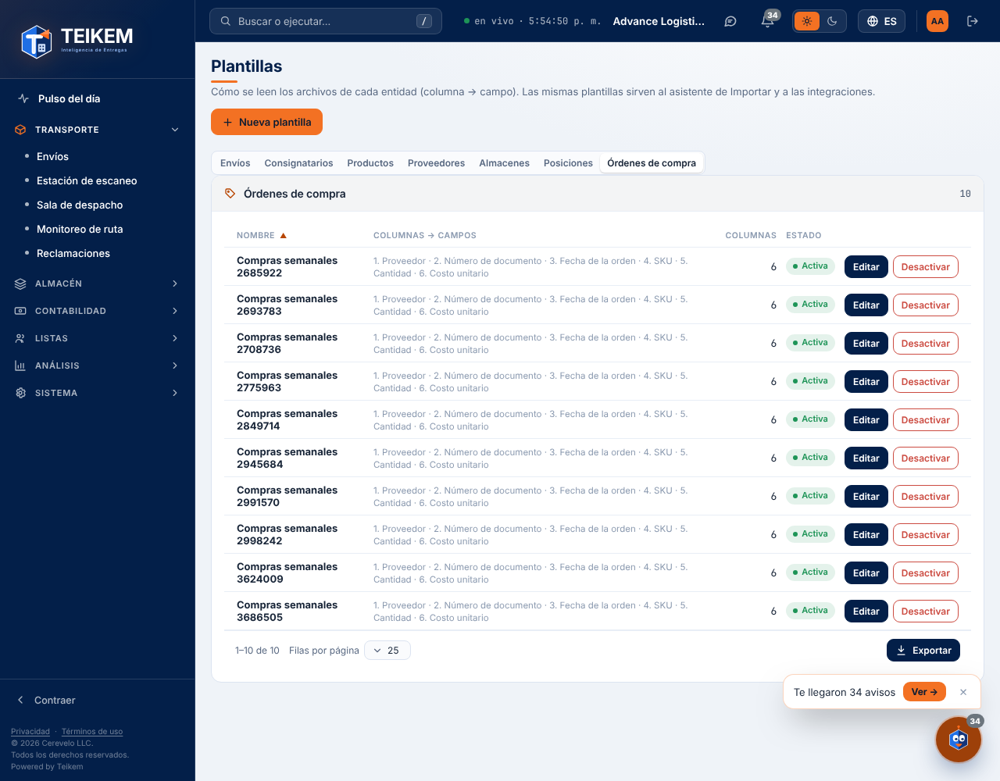

Qué se ve:
- El título «Plantillas», la frase «Cómo se leen los archivos de cada entidad (columna → campo)…» y el botón **«+ Nueva plantilla»**.
- Las pestañas Envíos, Consignatarios, Productos, Proveedores, Almacenes, Posiciones y **Órdenes de compra** (elegida).
- La tabla con **Nombre** (ordenable), **Columnas → Campos** (por ejemplo «1. Proveedor · 2. Número de documento · 3. Fecha de la orden · 4. SKU · 5. Cantidad · 6. Costo unitario»), **Columnas** (cuántas), **Estado** y los botones **Editar** y **Desactivar**. **No hay columna «Cliente»**: las plantillas de compras no llevan cliente. Cada fila mide dos líneas de texto (unos 49 px entre filas en la captura). Abajo, la paginación y **«Exportar»**.

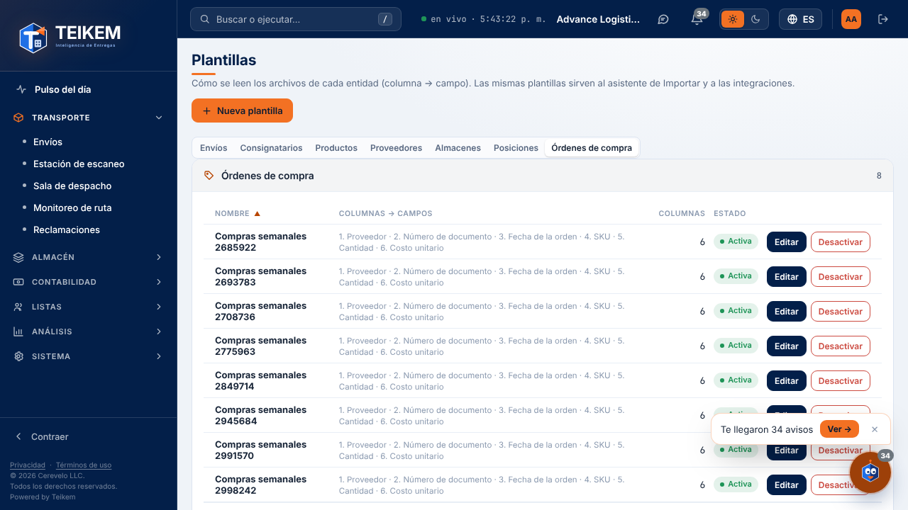

> En esta captura, el aviso «Te llegaron 34 avisos» (una notificación pasajera de la prueba) tapa una parte de los botones de dos filas. No es parte de la pantalla.

## 2. La ventana de la plantilla

**Cómo se usa.** «+ Nueva plantilla» (o **Editar** sobre una). Se abre la misma ventana que usan las plantillas de productos, proveedores, almacenes y posiciones: **Nombre**, **Delimitador**, el interruptor **«La primera fila es el encabezado»**, la tabla «Columna N → Campo destino» (con «— no importar —»), «Agregar columna» y «Valores por defecto». Los campos del desplegable son los de compras: Proveedor, Número de documento, Fecha de la orden, Fecha esperada, SKU, Descripción, Cantidad y Costo unitario. **Solo el Proveedor** admite valor por defecto. Guardar sin columnas, o sin una columna obligatoria, muestra el mensaje en rojo sobre el texto de ayuda («Indique al menos una columna.» en la captura; los otros son «La plantilla debe incluir la columna documentNumber / sku / quantity.» y «La plantilla debe indicar el proveedor…»).

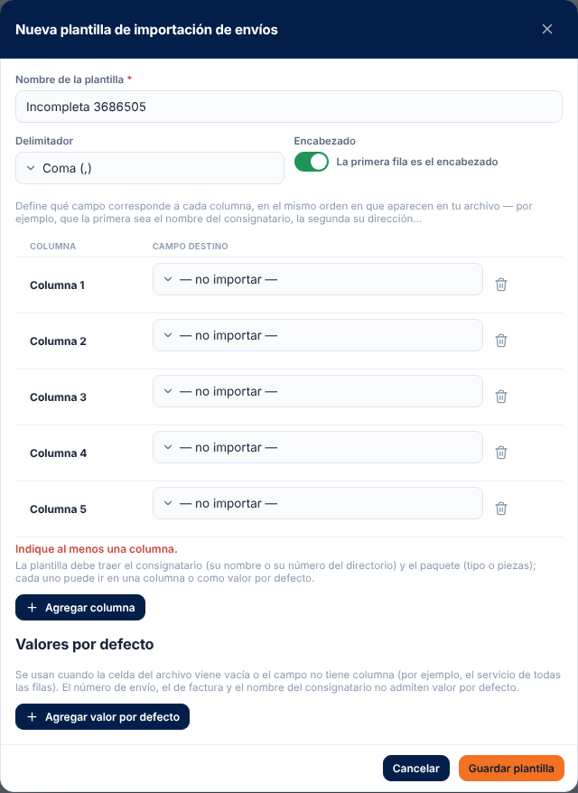

> **Corregido después del Lote 247 (sin commitear): la captura de abajo es anterior y todavía muestra el texto viejo.** Ahora el título es «Nueva plantilla de importación de órdenes de compra» y las ayudas hablan de número de orden, SKU, cantidad y proveedor (capítulo 54 §2). Lo que sigue describe lo que mostraba la captura. Antes, el título de esta ventana decía **«Nueva plantilla de importación de envíos»** y el texto de ayuda de las columnas hablaba de «el consignatario (su nombre o su número del directorio) y el paquete». Eran los textos de las plantillas de envíos: el editor no los cambiaba según el tipo. Para compras lo que vale son los cuatro obligatorios del capítulo 54 (número de documento, SKU, cantidad y proveedor). Ver la decisión 32 de [`lote246-decisiones.md`](../../lote246-decisiones.md).

## 3. Compras → Importar con la plantilla

**Quién puede.** `purchasing.manage`, módulo Compras. **«Nueva plantilla»** y **«Editar»** también necesitan `purchasing.manage` y **no** necesitan el módulo Integraciones.

**Cómo se usa.** Compras → **Importar** → **Origen del archivo: «Plantilla (la del usuario)»**. Aparece la lista **Plantilla** (solo las activas, con **«Nueva plantilla»** y **«Editar»** al lado) y, debajo, el estatus, el almacén y el archivo. «Revisar» no guarda nada.

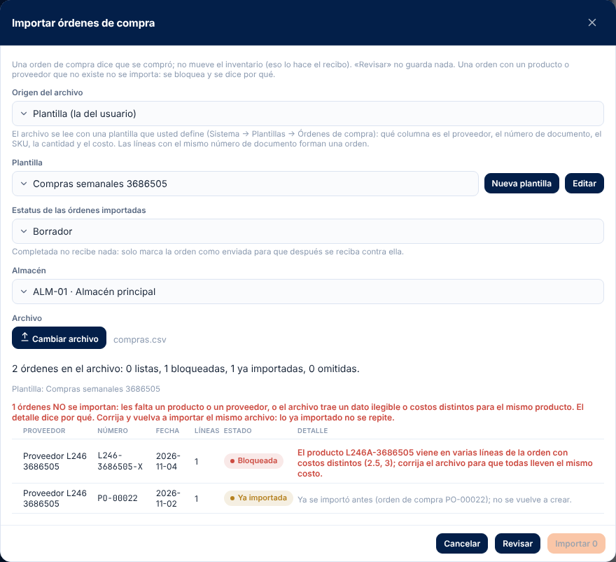

Qué se ve, de arriba abajo:
- La ayuda: «Una orden de compra dice que se compró; no mueve el inventario…», y bajo el origen, la ayuda del origen: «El archivo se lee con una plantilla que usted define (Sistema → Plantillas → Órdenes de compra)…».
- La **Plantilla**, con «Nueva plantilla» y «Editar»; **Estatus de las órdenes importadas** (Borrador o «Completada (enviada, lista para recibir)»); **Almacén**; **Archivo** (aquí «Cambiar archivo» y `compras.csv`).
- El resumen: «2 órdenes en el archivo: 0 listas, 1 bloqueadas, 1 ya importadas, 0 omitidas.» y, debajo, «Plantilla: Compras semanales …» (el nombre de la plantilla usada).
- La nota en rojo: «1 órdenes NO se importan: les falta un producto o un proveedor, o el archivo trae un dato ilegible o costos distintos para el mismo producto…».
- La tabla **Proveedor / Número / Fecha / Líneas / Estado / Detalle**: la orden `L246-…-X` sale **«Bloqueada»** con «El producto … viene en varias líneas de la orden con costos distintos (2.5, 3); corrija el archivo para que todas lleven el mismo costo.», y la orden `PO-00016` sale **«Ya importada»** con «Ya se importó antes (orden de compra PO-00016); no se vuelve a crear.».
- Los botones **Cancelar**, **Revisar** y **«Importar 0»** (apagado: no hay ninguna orden lista).

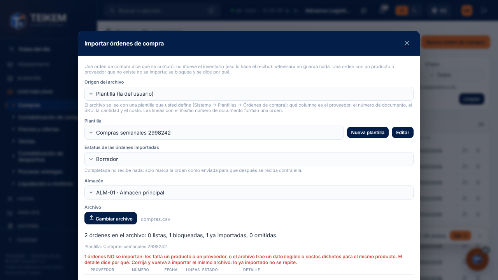

> «1 órdenes» y «1 bloqueadas» son los textos de siempre de esta ventana (no distinguen singular de plural).

## 4. Compras: la lista con «Origen» y «QuickBooks»

**Quién puede.** Ver: `purchasing.view`. El botón **«QuickBooks»** solo sale con `purchasing.quickbooks`.

**Cómo se usa.** Contabilidad → **Compras**. La barra de botones trae **«QuickBooks»**, **«Importar»** y **«Nueva orden de compra»**. Los filtros nuevos son **«Origen»** y **«QuickBooks»**; **«Limpiar»** los borra.

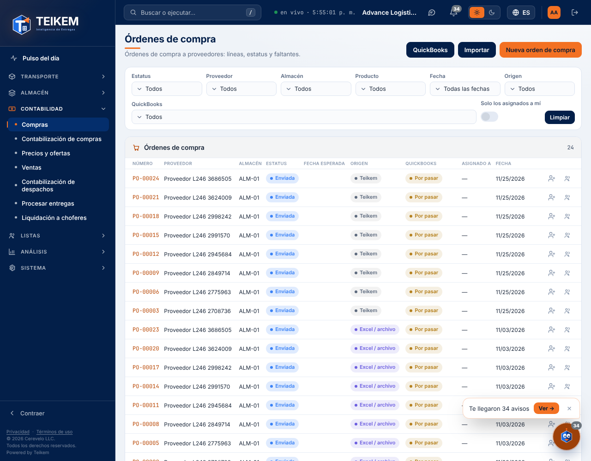

Qué se ve:
- Las columnas **«Origen»** (chip «Teikem» en gris, «Excel / archivo» en morado) y **«QuickBooks»** (chip «Por pasar» en ámbar, «En QuickBooks» en verde). Los chips no se envuelven.
- Cada fila mide una sola línea (unos 41 px entre filas en la captura). La lista de la captura tiene 18 órdenes; las filas visibles están «Enviada» y una de ellas está «En QuickBooks» (la fila `PO-00010`).
- En la fila de una orden «En QuickBooks» aparece además la acción **«Quitar la marca»** (con `purchasing.quickbooks`).

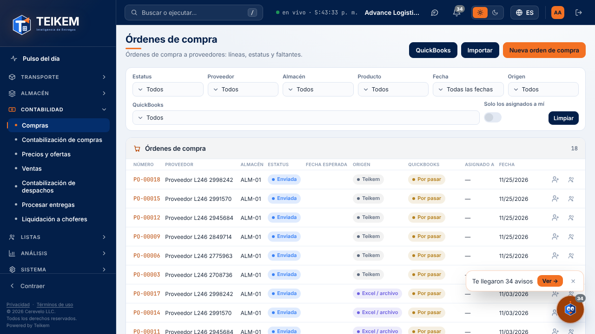

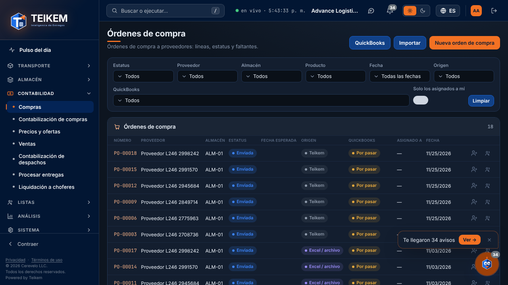

> En las capturas de la lista, el aviso «Te llegaron 34 avisos» tapa una parte de la columna «Asignado a». Es una notificación pasajera de la prueba.

## 5. La ventana «Pasar órdenes de compra a QuickBooks»

**Quién puede.** `purchasing.quickbooks`, módulo Compras.

**Cómo se usa.** Compras → **«QuickBooks»**.

Qué se ve, de arriba abajo:
- La ayuda: «Las órdenes enviadas, recibidas en parte o recibidas que faltan por pasar a QuickBooks Desktop. «Exportar» baja un archivo .iif (órdenes de compra) y no marca nada: después se pregunta si ya se importó. Las que vinieron de QuickBooks no salen aquí.».
- Un cuadro **«Avisos (no impiden exportar)»** con borde punteado. En la captura: «El término «NET30» no tiene nombre en QuickBooks (Ajustes → Operación → QuickBooks): el proveedor nuevo sale sin término.».
- El buscador, la casilla **«Todas las de la vista (17)»** y **«Marcar todas»**; la casilla **«Incluir proveedores y productos nuevos»** (encendida) con su explicación («5 proveedores y 10 productos todavía no se han mandado a QuickBooks…»).
- La tabla **Elegir / Fecha / Número / Proveedor / Total / Nuevo en QuickBooks / Archivo**: chips «Proveedor nuevo» y «2 productos nuevos» (o «Producto nuevo») con el enlace **«ver datos»**; una orden sin nada nuevo muestra «—». La columna «Archivo» sale en «—» porque ninguna se ha exportado.
- Abajo: **Cerrar**, **«Marcar 17 como en QuickBooks»** y **«Exportar 17»**.

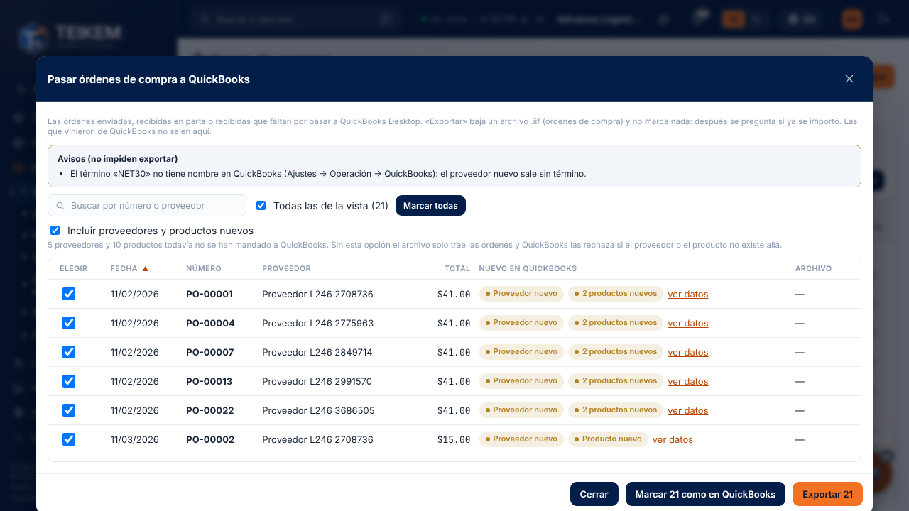

> **A revisar.** En las dos capturas de esta ventana, el botón **«Exportar 17»** se ve en gris, como apagado, aunque hay 17 órdenes elegidas y el recorrido lo pulsa sin problema. La clase de ese botón (`btn money`) es la misma del botón de exportar de ventas y del «Sí, ya están», que sí sale en naranja. Puede ser un cuadro tomado a mitad de la transición del color, pero **no se comprobó**. Lo mismo pasa con **«Pasar a QuickBooks…»** en la ficha (sección 6).

**Exportar y contestar.** «Exportar N» baja el archivo `teikem-quickbooks-compras-AAAAMMDD-HHMM.iif` y la ventana cambia a la pregunta:

- **Título:** «¿Ya las importaste en QuickBooks? (3)». Debajo, el nombre del archivo, «3 órdenes por $63.50» y «con 1 proveedores y 2 productos nuevos» (o «sin proveedores ni productos nuevos»).
- Los avisos, la ayuda «Importe el archivo en QuickBooks (Archivo → Utilidades → Importar → Archivos IIF) y conteste. Solo las marcadas cuentan; las desmarcadas no cambian.», la casilla «Todas (3)» y la lista de las órdenes del archivo con casilla, número, proveedor y total.
- Los botones: **«Bajar otra vez»**, **«Todavía no»** (cierra sin cambiar nada), **«No pasó (3)»** (en rojo con borde: vuelven a «Por pasar») y **«Sí, ya están (3)»** (naranja, con una palomita: quedan «En QuickBooks»).

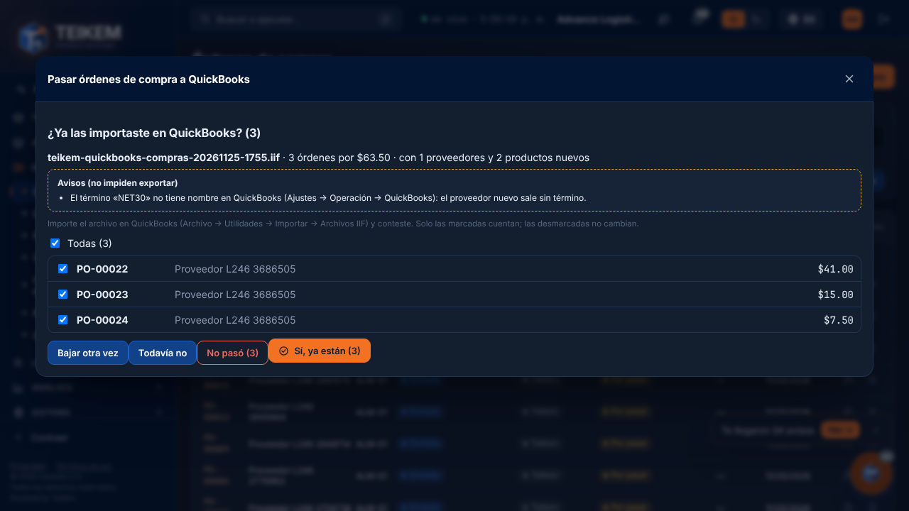

## 6. La ficha de la orden de compra

**Cómo se usa.** Compras → clic en una orden. Bajo el título, la franja de origen y estado:

- **Origen y estado:** chips «Excel / archivo» y «En QuickBooks», «Marcada el {fecha} por {persona}» y **«Quitar la marca»**.
- **Aviso:** «Esta orden ya salió hacia QuickBooks: editarla o cancelarla aquí no cambia nada allá. Ciérrela o corríjala en QuickBooks.» (sale en «En QuickBooks» y en «Exportada, por confirmar»).
- **Notas:** una orden importada trae «Importada con la plantilla «Compras semanales …» L246-2998242-2.» seguida de la marca de importación entre corchetes (`[IMP:…]`).

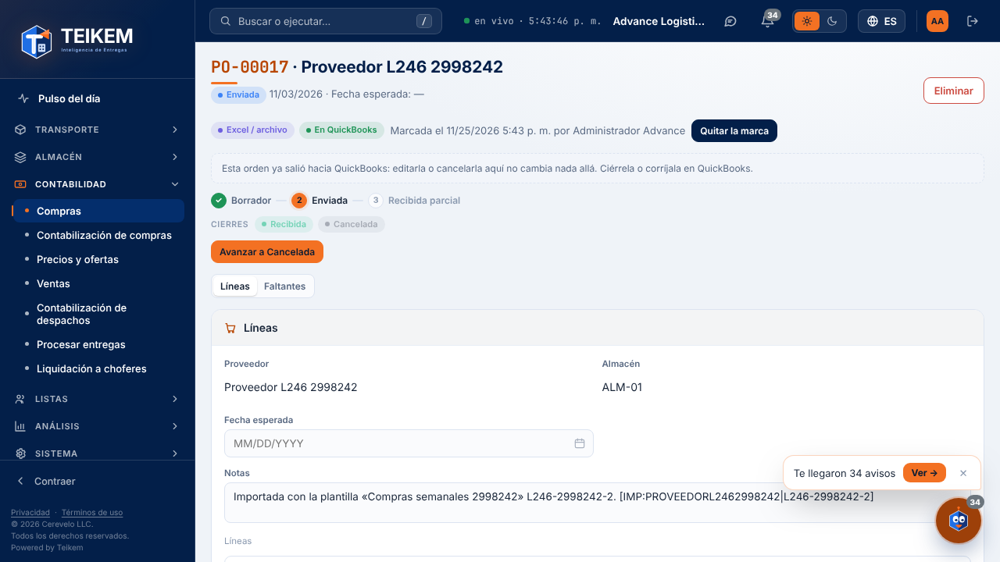

Una orden **«Por pasar»** muestra sus botones:

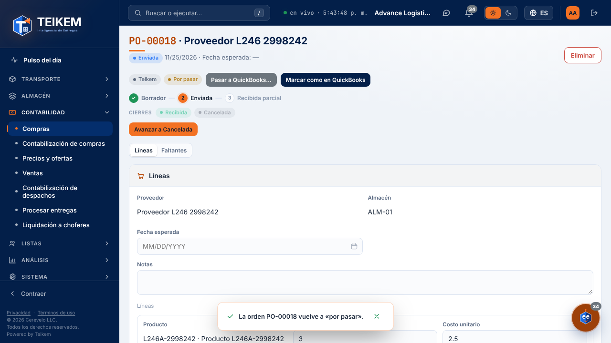

- Estados y botones de la ficha: **Por pasar** → «Pasar a QuickBooks…» y «Marcar como en QuickBooks»; **Exportada, por confirmar** → «Pasar a QuickBooks…», «Sí, ya está» y «No pasó» (con «Exportada el {fecha} por {persona}; falta confirmar que se importó»); **En QuickBooks** → «Quitar la marca»; **Vino de QuickBooks** y **No se pasa** → sin botones.
- «Pasar a QuickBooks…» abre la misma ventana de la sección 5 con **solo esa orden**.

## 7. Qué se midió y qué no

- **Medido en el recorrido (con el API de pruebas sin correo):** sin scroll horizontal de página en la plantilla, la lista y (en celular) la lista, el importador y la ventana de QuickBooks; filas de la plantilla y de la lista de 64 px o menos; chips sin envolverse (se ve en las capturas); los textos de las ventanas existen.
- **Visto en las capturas:** tema claro y oscuro de la lista y de la pregunta «¿Ya las importaste…?» (el resto de las capturas es solo en tema claro); los chips se leen bien en los dos temas.
- **No hay capturas** en inglés ni en celular dentro del manual.
- **Pendientes de las capturas** (ver las notas «A revisar» y «Texto pendiente» arriba): los textos de envíos del editor de plantilla, y el botón «Exportar» / «Pasar a QuickBooks…» que sale gris.
- **No se probó** el archivo IIF contra QuickBooks real.
