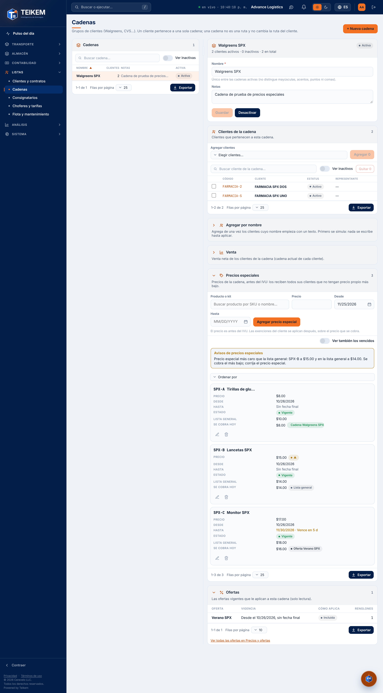
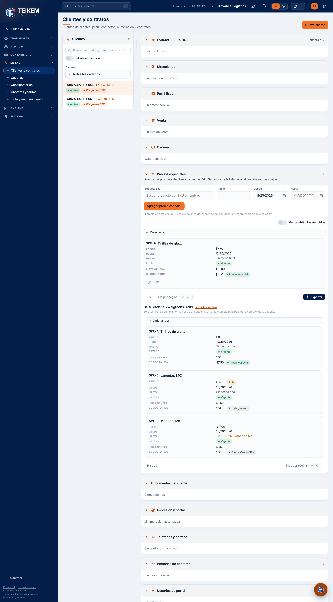
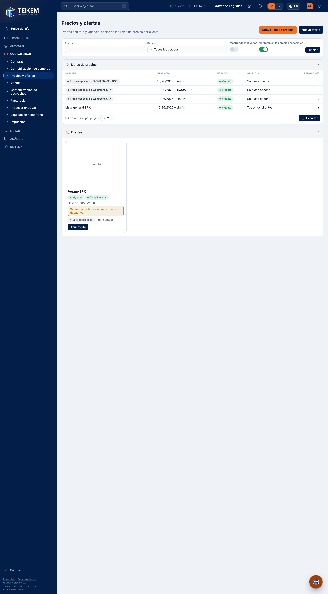
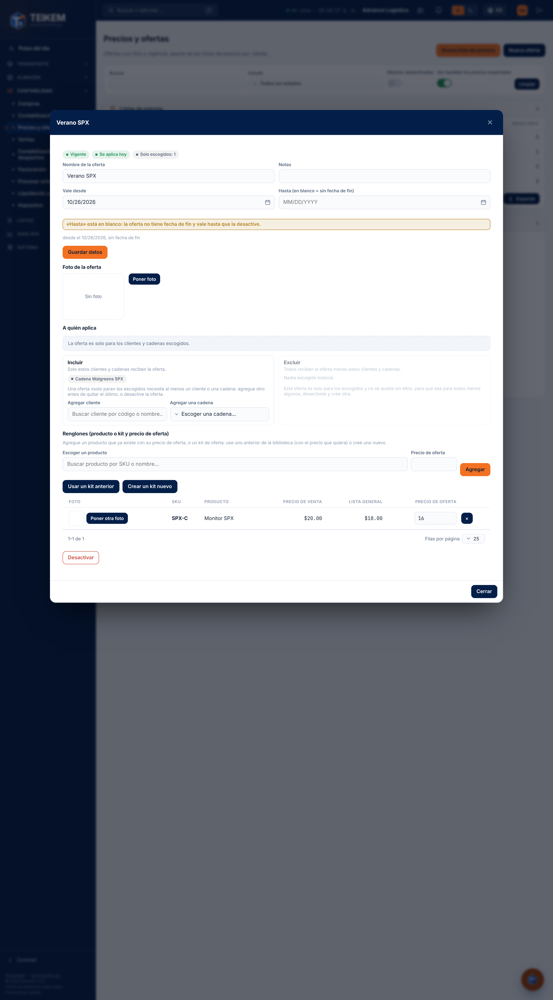
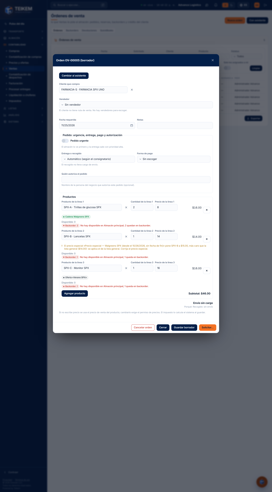
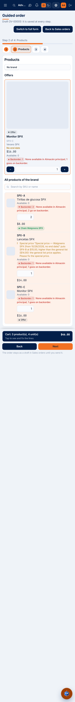

# L247 — Precios especiales y ofertas por cliente y por cadena (web del personal)

Lote 247 (2026-11-26). Seis pantallas cambian: la **ficha de la cadena** (Listas → Cadenas: paneles «Precios especiales» y «Ofertas»), la **ficha del cliente** (Listas → Clientes y contratos: panel «Precios especiales»), **Contabilidad → Precios y ofertas** (interruptor «Ver también los precios especiales», la lista dedicada y el editor de la oferta con «Incluir» y «Excluir») y la **orden de venta** y el **pedido guiado** (el origen de cada precio). Reglas, permisos y mensajes: [capítulo 55](../55-precios-especiales-y-ofertas.md). Cada mensaje de error: [FAQ](../faq.md).

Capturas del recorrido de `web-app/e2e/lote247-precios-especiales.spec.ts` con el API de pruebas **sin correo**; están en `img/l247-*.png` (24 imágenes: 6 pantallas × 4 aspectos). Los datos son los que crea el propio recorrido: la cadena «Walgreens SPX» con dos clientes («FARMACIA SPX UNO» y «FARMACIA SPX DOS»), tres productos (SPX-A, SPX-B, SPX-C), la «Lista general SPX» (A = 10, B = 14, C = 18), precios especiales de la cadena (A = 8, B = 15, C = 17 hasta el 30/11/2026), uno del cliente DOS (A = 7.50), la oferta «Verano SPX» (C = 16, solo para la cadena) y una orden en borrador del cliente UNO. Cuatro corridas: **1440 px en español con tema claro** (`escritorio-es-light`), **1440 px en inglés con tema oscuro** (`escritorio-en-dark`), **390 px en español con tema oscuro** (`movil-es-dark`) y **390 px en inglés con tema claro** (`movil-en-light`). Cada corrida comprueba que no haya scroll horizontal de la página, que las filas de las tablas midan 56 px o menos (donde la tabla es tabla) y que los paneles no se desborden. **Las capturas de este documento son las de escritorio en español con tema claro; las otras tres variantes de cada pantalla tienen el mismo nombre con su sufijo** (por ejemplo `l247-cadena-movil-es-dark.png`).

> **Textos en el idioma de la interfaz.** En las capturas en inglés el aviso de precio, el nombre de la lista dedicada («Special price — Walgreens SPX (from 10/26/2026 to 11/30/2026)») y la vigencia de la oferta («from 10/26/2026, no end date») salen en inglés y con las fechas de la compañía (MM/DD/AAAA). El servidor conserva el español solo como respaldo.

## 1. Ficha de la cadena: «Precios especiales» y «Ofertas»

**Quién puede.** Ver: `sales.view` o `sales.pricelist` (y `sales.chain` / `clients.read` / `sales.view` para abrir Cadenas). Agregar, cambiar y quitar: `sales.pricelist`. Módulo `SALES_ORDERS`.

**Cómo se usa.** Listas → **Cadenas** → la cadena. Debajo de «Clientes de la cadena», «Agregar por nombre» y «Venta» hay dos paneles nuevos.

Qué se ve:
- A la izquierda la lista de cadenas (una sola, «Walgreens SPX», con 2 clientes); a la derecha la ficha, en una columna: nombre y notas, «Clientes de la cadena», «Agregar por nombre» (plegado), «Venta» (plegado), **«Precios especiales»** y **«Ofertas»** (los dos abiertos).
- **«Precios especiales»** (contador 3): «Precios de la cadena, antes del IVU: los reciben todos sus clientes que no tengan precio propio más bajo.» Una fila para agregar con **Producto o kit**, **Precio**, **Desde** (hoy) y **Hasta**, el botón naranja **«Agregar precio especial»** y la ayuda «El precio es antes del IVU. Las exenciones del cliente se aplican después, sobre el precio que se cobra.» A la derecha, el interruptor **«Ver también los vencidos»** (apagado).
- El recuadro ámbar **«Avisos de precios especiales»**: «Precio especial más caro que la lista general: SPX-B a $15.00 y en la lista general a $14.00. Se cobra el más bajo; corrija el precio especial.»
- Los tres precios, **como tarjetas** (la ficha es angosta para una tabla de siete columnas): cada una con **Precio**, **Desde**, **Hasta**, **Estado**, **Lista general** y **Se cobra hoy**, y los botones de lápiz y papelera.
  - **SPX-A**: $8.00, vigente, sin fecha final; lista general $10.00; **se cobra hoy $8.00 con el chip verde «Cadena Walgreens SPX»**.
  - **SPX-B**: $15.00 con un **triángulo ámbar** (más caro que la lista general); lista general $14.00; **se cobra hoy $14.00 con el chip gris «Lista general»**.
  - **SPX-C**: $17.00, «Hasta» en ámbar «11/30/2026 · Vence en 5 d»; lista general $18.00; **se cobra hoy $16.00 con el chip «Oferta Verano SPX»** (la oferta es más barata que el precio de la cadena).
- Debajo, el botón «Ordenar por» y la paginación con «Exportar».
- **«Ofertas»** (contador 1), solo lectura: «Las ofertas vigentes que le aplican a esta cadena (solo lectura).» Una tabla con **Oferta**, **Vigencia**, **Cómo aplica** y **Renglones**: «Verano SPX», «Desde el 10/26/2026, sin fecha final», chip **«Incluida»**, 1. Abajo, el enlace «Ver todas las ofertas en Precios y ofertas».

> En el escritorio los precios salen como tarjetas, no como tabla, porque el panel mide menos que el ancho mínimo de la tabla. El recorrido mide las filas solo cuando hay tabla.

Las mismas pantallas en inglés con tema oscuro (`l247-cadena-escritorio-en-dark.png`: «Special prices», «Charged today», chip «Chain Walgreens SPX», «Offers» con «Included») y en celular (`l247-cadena-movil-es-dark.png`, 390 px): el panel ocupa todo el ancho y cada precio es una tarjeta, sin scroll horizontal.

## 2. Ficha del cliente: «Precios especiales»

**Quién puede.** Igual que arriba. Módulo `SALES_ORDERS`.

**Cómo se usa.** Listas → **Clientes y contratos** → el cliente → panel **«Precios especiales»** (la ficha arranca con los paneles plegados; ábralo con su título).

Qué se ve:
- La lista de clientes a la izquierda (con el filtro «Cadena» y el chip naranja «Walgreens SPX» en cada cliente) y la ficha a la derecha: «Direcciones», «Perfil fiscal», «Venta», «Cadena» (dice «Walgreens SPX») y **«Precios especiales»** (contador 1).
- «Precios propios de este cliente, antes del IVU. Ganan sobre la lista general cuando son más bajos.» La fila de alta, la ayuda del IVU y «Ver también los vencidos».
- **Su precio propio:** SPX-A **$7.50**, vigente, sin fecha final, lista general $10.00, **se cobra hoy $7.50 con el chip «Precio especial»**. Gana al de la cadena ($8.00) por ser más bajo.
- **«De su cadena «Walgreens SPX»»** con el enlace **«Abrir la cadena»** y la ayuda «Solo lectura: se cambian en la ficha de la cadena. Un precio propio más bajo gana sobre el de la cadena.» Debajo, los tres precios de la cadena, **sin lápiz ni papelera**. Lo que se cobra hoy **a este cliente**: SPX-A $7.50 «Precio especial» (el suyo, no el de la cadena), SPX-B $14.00 «Lista general» y SPX-C $16.00 «Oferta Verano SPX».
- Más abajo siguen «Documentos del cliente», «Impresión y portal», «Teléfonos y correos», etc., como siempre. En esta captura no hay ninguna lista normal que incluya al cliente, por eso no sale «Listas de precios que lo incluyen».

En celular (`l247-cliente-movil-es-dark.png`, 390 px, tema oscuro) la ficha es una columna: la fila de alta pasa a un campo por línea y cada precio es una tarjeta con «Se cobra hoy» y su chip; no hay scroll horizontal.

## 3. Precios y ofertas: el interruptor y las listas dedicadas

**Quién puede.** `sales.pricelist` (la pantalla). Módulo `SALES_ORDERS`.

**Cómo se usa.** Contabilidad → **Precios y ofertas**. El filtro trae el interruptor nuevo **«Ver también los precios especiales»** (apagado por omisión; se recuerda).

Qué se ve:
- Arriba, **Buscar**, **Estado**, **Mostrar desactivadas**, **Ver también los precios especiales** (encendido, verde) y **Limpiar**; a la derecha **Nueva lista de precios** y **Nueva oferta**.
- **Listas de precios** (4), una tabla con **Nombre**, **Vigencia**, **Estado**, **Aplica a** y **Renglones**. Las dedicadas llevan el nombre como chip gris **«Precio especial de FARMACIA SPX DOS»** (Aplica a «Solo ese cliente») y **«Precio especial de Walgreens SPX»** (dos, de vigencias distintas: «10/26/2026 – 11/30/2026» y «10/26/2026 – sin fin»; «Solo esa cadena»). «Lista general SPX» sale con su nombre normal y «Todos los clientes». Con el interruptor apagado solo sale esta última. Las filas miden una línea.
- **Ofertas** (1): la tarjeta «Verano SPX» con «Vigente», «Se aplica hoy», «Desde el 10/26/2026», el recuadro ámbar «Sin fecha de fin: vale hasta que la desactive», el chip **«Solo escogidos: 1»** y «Abrir oferta».

Al abrir una lista dedicada:
- Los chips «Vigente» y **«Precio especial de Walgreens SPX»**.
- La nota: «Esta lista es el precio especial de «Walgreens SPX»: su nombre, fechas y a quién aplica se cambian en «Precios especiales» de su ficha. Aquí puede cambiar precios, publicar o desactivar.» con el enlace **«Abrir la ficha»**.
- **Nombre**, **Vigente desde**, **Hasta** y «Aplica a todos los clientes» (desmarcado), que **no se pueden cambiar** (el recorrido comprueba que el nombre está deshabilitado). El nombre dice «del 26/10/2026 al 30/11/2026» (día/mes/año) mientras el campo «Hasta» dice 11/30/2026: el servidor lo arma así.
- El renglón (SPX-C, precio de venta $20.00, **precio 17**, «Poner foto», quitar) sigue editable, y abajo **«Volver a borrador»** y **«Desactivar»**. No hay secciones de clientes ni de cadenas.

## 4. El editor de la oferta: «Incluir» y «Excluir»

**Quién puede.** `sales.pricelist`. Módulo `SALES_ORDERS`.

**Cómo se usa.** Precios y ofertas → «Abrir oferta» en la tarjeta (o «Nueva oferta»).

Qué se ve:
- Los chips del estado: «Vigente», «Se aplica hoy» y «Solo escogidos: 1». Después, nombre, notas, «Vale desde» y «Hasta (en blanco = sin fecha de fin)» con el aviso ámbar ««Hasta» está en blanco: la oferta no tiene fecha de fin y vale hasta que la desactive.» y la foto.
- **«A quién aplica»**: «La oferta es solo para los clientes y cadenas escogidos.» y dos cajas lado a lado.
  - **«Incluir»** («Solo estos clientes y cadenas reciben la oferta.»): el chip **«Cadena Walgreens SPX»** con su ×, el buscador **«Agregar cliente»** y el desplegable **«Agregar una cadena»** («Escoger una cadena…»).
  - **«Excluir»** («Todos reciben la oferta menos estos clientes y cadenas.»): en gris, con «Nadie escogido todavía.» y **«Quite lo escogido en la otra caja para usar esta.»** Está deshabilitada mientras «Incluir» tenga a alguien.
- **Renglones:** el producto SPX-C con precio de venta $20.00, **lista general $18.00** y precio de oferta 16, «Usar un kit anterior» y «Crear un kit nuevo». Abajo «Desactivar».
- La caja **«Incluir»** muestra el chip «Cadena Walgreens SPX» **sin ×** (es el último: no se puede quitar) y debajo el mensaje «Una oferta «solo para» los escogidos necesita al menos un cliente o una cadena: agregue otro antes de quitar el último, o desactive la oferta.» (por API da 409). La caja **«Excluir»** queda deshabilitada con «Esta oferta es solo para los escogidos y no se queda sin ellos: para que sea para todos menos algunos, desactívela y cree otra.»

En celular (`l247-oferta-movil-en-light.png`) las dos cajas pasan una debajo de la otra y la ventana usa todo el alto, con la misma sección «Who it applies to» («Include» y «Exclude») en inglés.

## 5. La orden y el pedido guiado: el origen de cada precio

**Quién puede.** Ver la orden: `sales.view`. Escribir un precio distinto del que salió (precio manual): `sales.price`. Módulo `SALES_ORDERS`.

**Cómo se usa.** Contabilidad → **Ventas** → una orden en borrador (modo «Formulario»). En el escritorio, la ventana de la orden muestra el origen debajo de cada línea.

Qué se ve:
- El cliente «FARMACIA-S · FARMACIA SPX UNO», la fecha, el pedido (urgente, entrega, pago, autorización) y la lista de **Productos**.
- Línea 1: SPX-A, cantidad 2, precio 8 (importe $16.00), chip verde **«Cadena Walgreens SPX»**. Línea 2: SPX-B, cantidad 1, precio 14 ($14.00), **sin chip** (sale de la lista general). Línea 3: SPX-C, cantidad 1, precio 16 ($16.00), chip gris **«Oferta «Verano SPX»»**.
- Cada línea además dice «Disponible: 0» y el aviso rojo de backorder del almacén de la prueba; no tiene que ver con el lote.
- La línea 2 (SPX-B, $14.00, sin chip) muestra el aviso ámbar «El precio especial «Precio especial — Walgreens SPX (desde el 10/26/2026, sin fecha de fin)» pone SPX-B a $15.00, más caro que la lista general ($14.00): se aplica el de la lista general. Corrija el precio especial.» junto a la línea (lista «Avisos de precio de {SKU}»), igual que en el pedido guiado.

En el celular, el borrador abre el **pedido guiado** (paso 2 de 4, «Products»). Se ve:
- La tarjeta de la oferta «Monitor SPX» a $16.00, «Verano SPX», «No end date».
- En «All products of the brand»: SPX-A a $8.00 con el chip «Chain Walgreens SPX» completo bajo la cantidad, SPX-B a $14.00 con el **aviso ámbar** en inglés («Special price “Special price — Walgreens SPX (from 10/26/2026, no end date)” puts SPX-B at $15.00, higher than the general list ($14.00)…»; la prueba `ProductsStep.offers.test.tsx` lo fija), y SPX-C a $16.00 con el chip «Offer».
- El carrito: «Cart: 3 product(s), 4 unit(s)», $46.00.

> **Corregido en este lote.** El chip de origen de SPX-A («Chain Walgreens SPX») y el precio quedan completos bajo la cantidad; antes el chip se cortaba por la izquierda en celular (la regla móvil de `wizard.css` no mandaba el precio a la columna ancha).

Una orden ya **solicitada** sigue mostrando el origen guardado de sus líneas aunque después cambie la lista; las líneas de órdenes anteriores al lote no tienen chip (no hay captura de ese caso). Si una línea tiene precio manual, la pantalla muestra «Precio manual» y, al lado, «Lista: {precio}» (cubierto por pruebas de componentes; no hay captura).

## 6. Lo que las capturas no cubren

- **Quitar y editar un precio especial** (el diálogo «Cambiar el precio especial de {SKU}», la confirmación «¿Quitar el precio especial?»), el estado vacío («Sin precios especiales»), un cliente **inactivo** («Está inactivo: no admite precios nuevos.»), «Ver también los vencidos» encendido y los errores del servidor en pantalla: no tienen captura (los cubren pruebas de componentes y pruebas del servicio).
- **«Listas de precios que lo incluyen»** (los chips «por el cliente» y «por su cadena»): no hay captura porque la prueba no crea listas normales para los clientes.
- **Editor de la lista de precios con la sección «Cadenas»:** no hay captura (la captura de la lista abierta es de una dedicada, que no la muestra).
- **Aviso en la orden en modo formulario:** ver arriba; el recorrido no lo comprueba.
