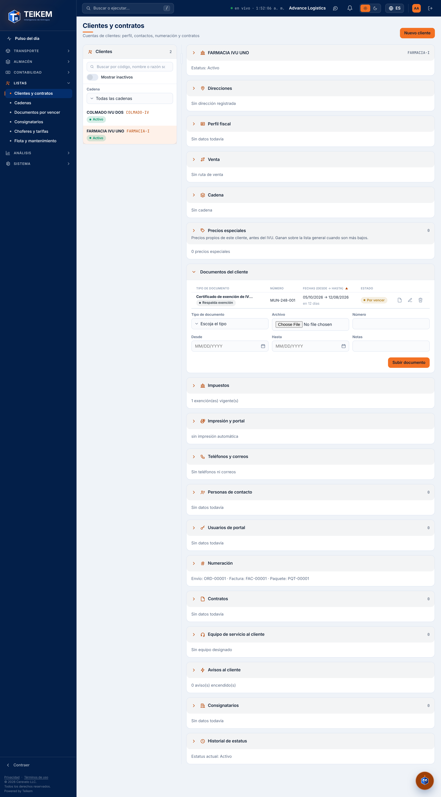
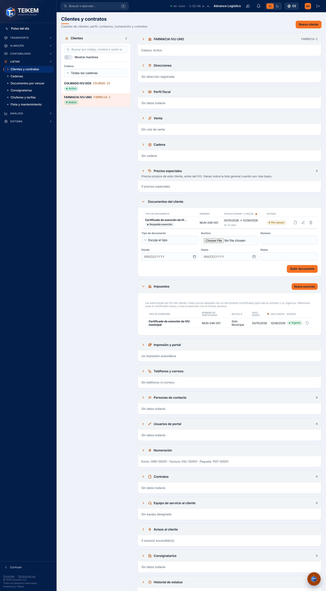
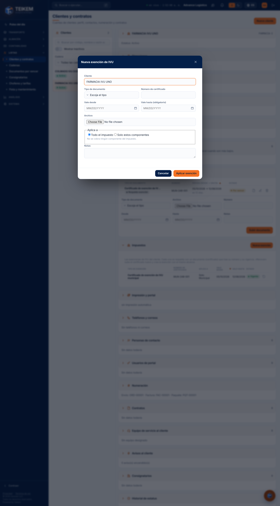
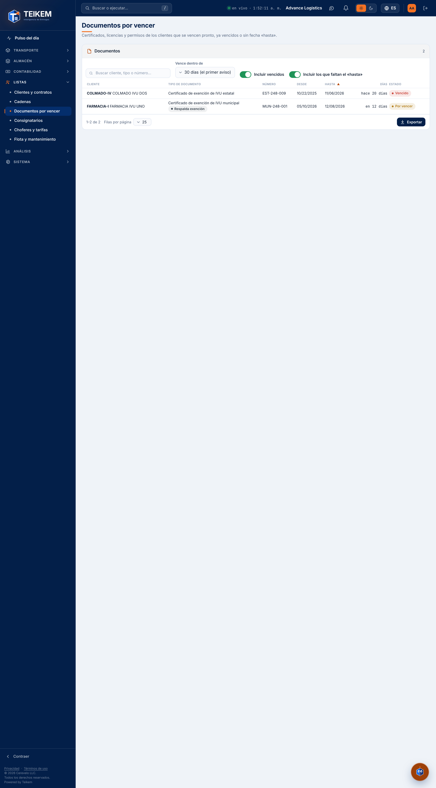
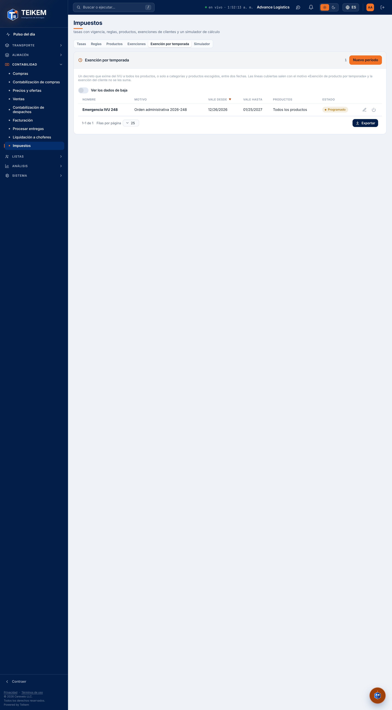
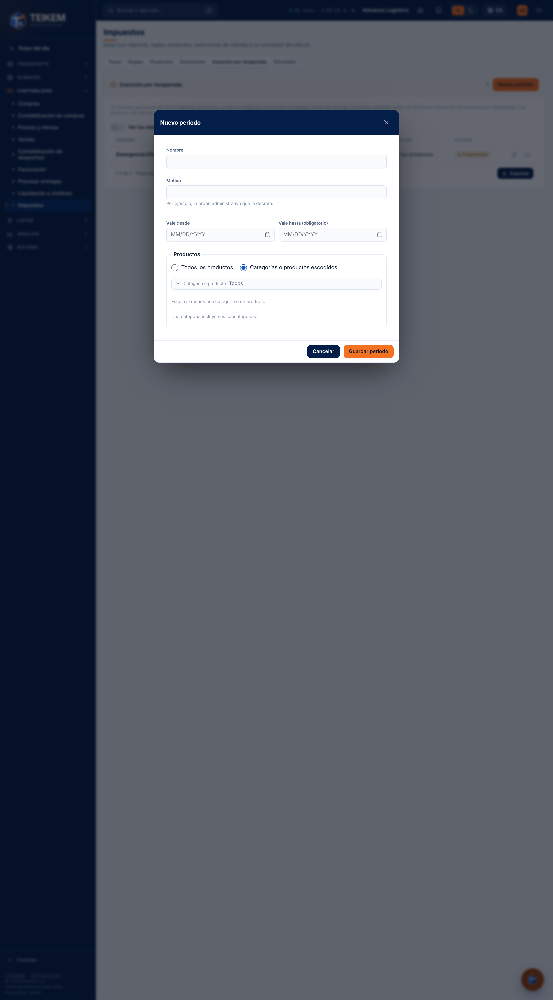
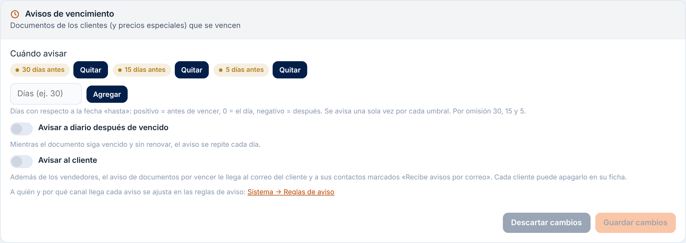
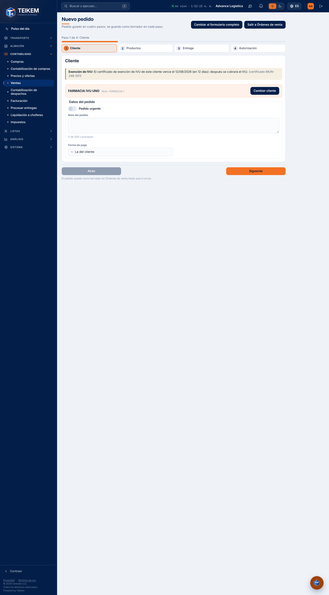

# Documentos con vigencia, exención de IVU y avisos de vencimiento (pantallas, Lote 248)

Para el personal. Las reglas y los mensajes de error exactos están en el capítulo funcional del lote; aquí se ve dónde está cada cosa.

## Ficha del cliente › Documentos del cliente
Cada documento muestra tipo, número, fechas (desde → hasta), días que faltan y el estado: Vigente, Por vencer, Vencido, Renovado, Falta «hasta» o Sin vigencia. La marca «Respalda exención» sale en el documento que sostiene una exención de IVU. Acciones por fila: abrir el archivo, editar (número, fechas y nota) y quitar. Un documento que respalda una exención vigente no se puede quitar (el mensaje del servidor sale en el diálogo) y cambiar su número o sus fechas exige el permiso de impuestos.

Al subir, «Hasta» es obligatorio si el tipo lleva vigencia. Si el tipo es «de impuestos» y la persona tiene permiso de impuestos y el módulo está encendido, el programa pregunta «¿Aplicar la exención de IVU?» y abre la captura de la exención con ese documento.

## Ficha del cliente › Impuestos
Las exenciones del cliente con el documento que las respalda. «Nueva exención» sube el certificado y crea la exención en un solo paso (alcance: todo el impuesto o solo los componentes marcados, por ejemplo el municipal). «Renovar» hace lo mismo partiendo del alcance anterior. Una exención vieja sin documento sigue valiendo y sale con «Falta el documento».

## Listas › Documentos por vencer
Documentos que vencen dentro de la ventana (por omisión, el primer aviso de la compañía), vencidos y sin «hasta»; sin los renovados. Buscador libre, filtro de días e interruptores. El nombre del cliente lleva a su ficha.

## Contabilidad › Impuestos
- **Exenciones**: columna de documento, chip «Falta el documento» y acción «Vincular documento». «Nueva exención» es la captura única.
- **Exención por temporada**: períodos con estado (Programado, Vigente, Terminado, De baja). Un período programado se edita completo; uno vigente solo permite cambiar la fecha final o darlo de baja.

## Ajustes › Operación › Avisos de vencimiento
Umbrales en días (por omisión 30, 15 y 5), «Avisar a diario después de vencido» y «Avisar al cliente». A quién llega cada aviso se ajusta en Sistema → Reglas de aviso.

## Catálogos de valores › Tipos de documento del cliente
Interruptores «Lleva vigencia» y «Es de impuestos» en cada tipo.

## Ficha del cliente › Avisos al cliente
«Documentos por vencer» solo sale por correo (bandeja y SMS apagados) y sigue a la compañía; el cliente lo puede apagar.

## Al vender
Aviso que no bloquea, en el paso Cliente del pedido guiado, en el resumen y en la orden: «El certificado de exención de IVU de este cliente vence el … (en N días)» o «venció el …». El texto se arma en la web con el idioma de la interfaz.

Todas las pantallas se revisaron en claro y oscuro, en español e inglés, a 1440 px y a 390 px, sin scroll horizontal.
