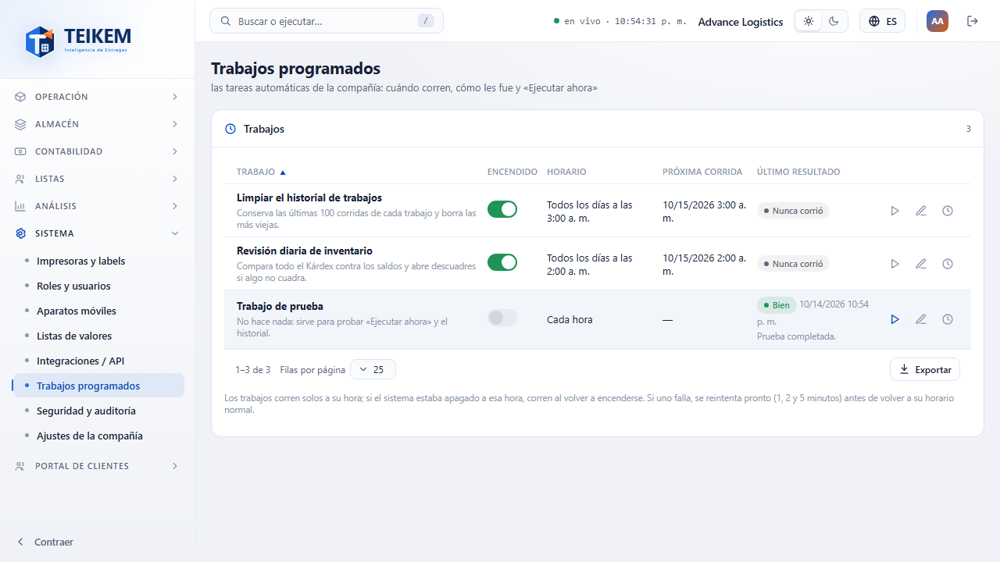
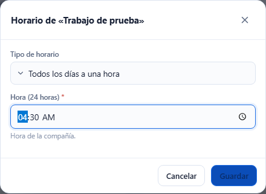
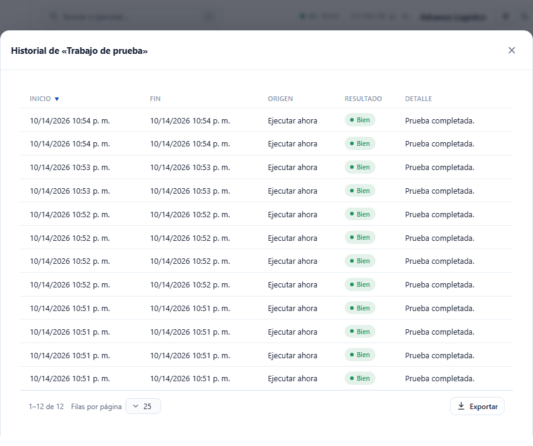

# L50 — Trabajos programados

**Sistema → Trabajos programados** (`/system/jobs`). Quién la ve: quien tiene el permiso **`jobs.manage`** («Gestionar los trabajos
programados»; lo trae el rol Admin de compañía). Módulo Sistema (siempre encendido). Sin el permiso, la entrada no aparece en el menú y la
dirección muestra «Sin permiso». Las reglas, los mensajes con su código y lo de soporte están en el capítulo
[13 — Trabajos programados](../13-trabajos-programados.md).

## 1. La lista

Una fila por trabajo (en teléfono, una tarjeta): nombre con su descripción, **Encendido** (interruptor), **Horario**, **Próxima corrida**
(vacía si está apagado; «Pedido: en unos segundos» si pidió «Ejecutar ahora»), y **Último resultado** (*Bien*, *Falló*, *Corriendo* o *Nunca
corrió*, con su hora y el resumen o el error). Mientras algo corre o espera su turno, la pantalla se actualiza sola cada 5 segundos.
**Exportar** baja la lista.

## 2. Ejecutar ahora

El botón ▶ de la fila. Avisa ««…» se ejecutará en unos segundos.»; el sistema la toma enseguida (aunque el trabajo esté apagado) y el
resultado aparece en la misma fila.

## 3. Cambiar horario

El lápiz de la fila abre **Horario de «…»**: *Cada cierto tiempo* (número y unidad: minutos, horas o días; de 1 minuto a 7 días) o *Todos los
días a una hora* (24 horas, hora de la compañía). Un valor fuera de rango muestra el mismo mensaje que el servidor y no guarda.

## 4. Historial

El reloj de la fila abre **Historial de «…»** con las últimas corridas: inicio, fin, origen (*Por horario* o *Ejecutar ahora*), resultado y
detalle (el error si falló).

Funciona de 360 px en adelante sin scroll horizontal de página.
