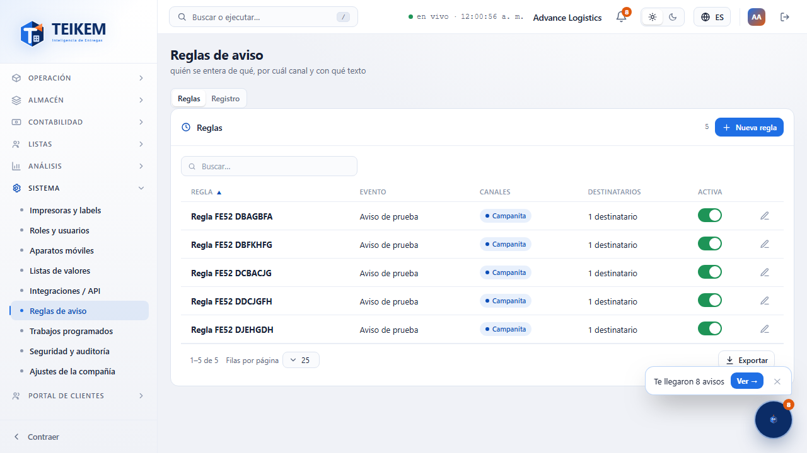
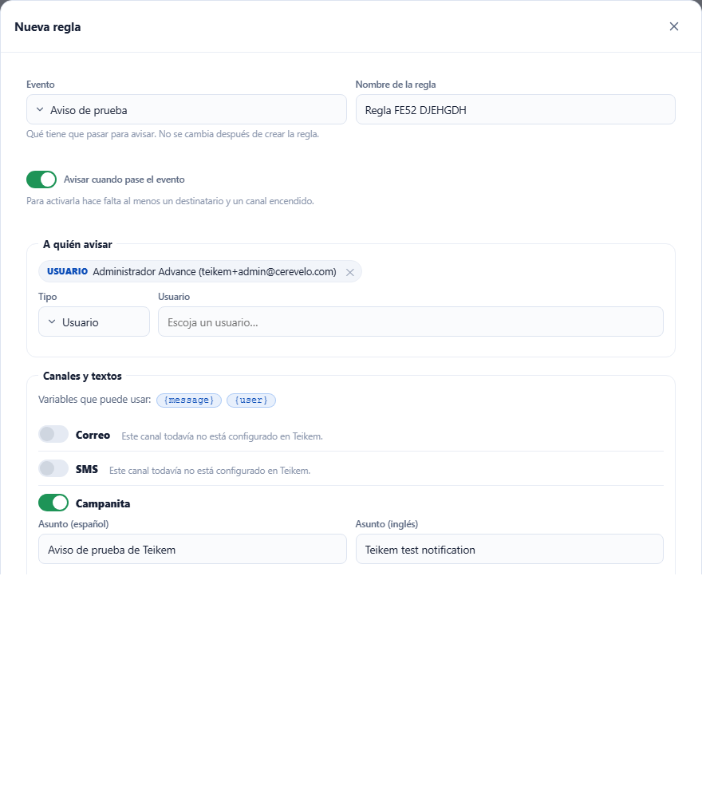
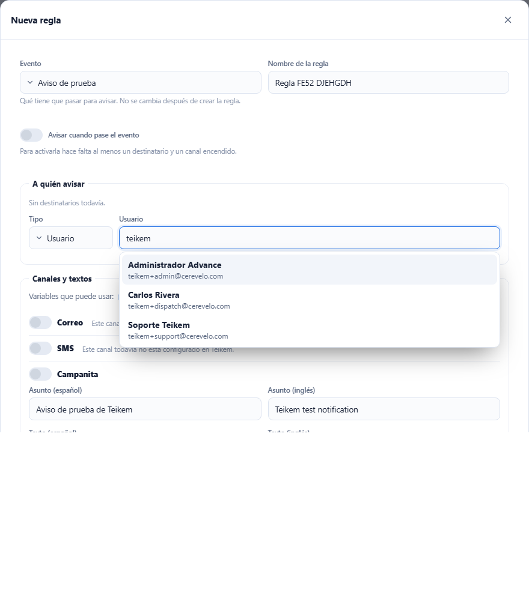
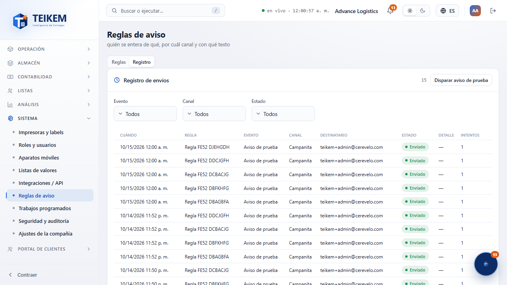
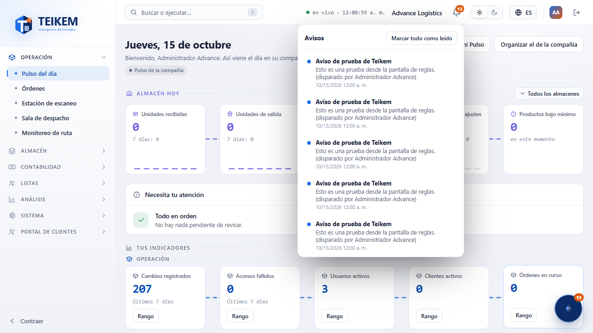
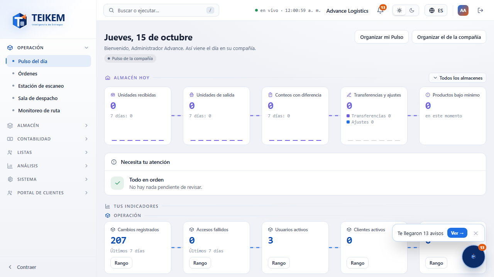
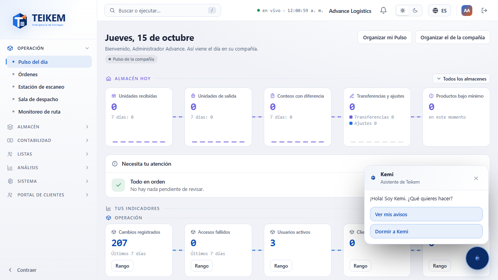
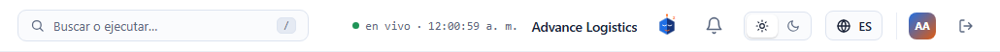

# L52 — Reglas de aviso, campanita y Kemi

Tres piezas que usan el motor de avisos del Lote 51 (capítulo [14 — Avisos](../14-avisos.md)):

1. **Sistema → Reglas de aviso** (`/system/notifications`): quién se entera de qué, por cuál canal y con qué texto. Permiso **`notifications.manage`**
   («Gestionar las reglas de aviso»; lo trae el rol Admin de compañía). Módulo Sistema (siempre encendido). Sin el permiso, la entrada no aparece en el menú.
2. **La campanita** de la cabecera: los avisos de **quien inició sesión** (cada quien ve solo los suyos; no necesita permiso).
3. **Kemi**, el asistente de Teikem: **anuncia** los avisos nuevos y ofrece opciones; **no reemplaza** la campanita.

## 1. Reglas de aviso

Pestaña **Reglas**: una fila por regla con su **evento**, los **canales encendidos**, cuántos **destinatarios** tiene y su interruptor **Activa**
(una regla apagada se ve atenuada). El lápiz abre **Editar regla**; **Nueva regla** abre el mismo cuadro vacío. Hay buscador y **Exportar**.

### Nueva regla / Editar regla

- **Evento**: qué tiene que pasar para avisar. Se escoge al crear y **no se cambia** después (para otro evento, cree otra regla). Hoy existe el **Aviso de prueba**; los avisos de cada módulo se irán sumando.
- **Nombre de la regla**: único en la compañía (hasta 100 caracteres).
- **Avisar cuando pase el evento**: activa la regla. Para activarla hace falta **al menos un destinatario y un canal encendido**.
- **A quién avisar**: escoja el **Tipo** y agregue.
  - **Rol**: le llega a todos los usuarios activos de ese rol.
  - **Usuario**: escriba parte del nombre o del correo y el buscador lista a las personas con su **nombre y su correo**; escoja con el ratón o con las flechas y Enter.
  - **Correo** o **Teléfono**: para alguien que no es usuario (el teléfono se guarda, pero no se usa hasta que haya SMS). Se valida el formato.
  Cada destinatario sale como una ficha con su ✕ para quitarlo; no se repiten.

- **Canales y textos**: **Correo**, **SMS**, **Campanita** y **Push**. Cada uno tiene su interruptor y, encendido, su **asunto** (correo y campanita) y su **texto** en **español y en inglés**.
  Las **{variables}** del evento aparecen como fichas: un clic la inserta donde está el cursor. Una variable que el evento no tiene se rechaza al guardar.
- **Canales sin configurar**: **SMS** y **Push** (aún sin proveedor) y **Correo** (si el servidor no tiene el correo de Teikem configurado) salen **apagados**, sin poder encenderse, con la nota
  «Este canal todavía no está configurado en Teikem.».
- **Enviar prueba** (al editar, por canal): manda el texto **guardado**, con valores de ejemplo, **a quien la pide**. Avisa si salió, si se omitió (y por qué) o si falló.
- Los errores del servidor se muestran tal cual (ver capítulo 14 §7) y el cuadro sigue abierto.

## 2. Registro

Pestaña **Registro**: cada envío (cuándo, regla, evento, canal, destinatario, **estado** —Enviado, Omitido, Falló, En proceso—, detalle e intentos), con filtros por **Evento**, **Canal** y **Estado**, paginado y con **Exportar** (todo lo filtrado).
**Disparar aviso de prueba** pone el evento de prueba en la cola real: lo reciben las reglas **activas** de ese evento (en unos segundos).

## 3. La campanita

El ícono de campana de la cabecera (junto al tema) muestra cuántos avisos tiene **sin leer** (99+ si pasan de 99). Al abrirla:
- Lista los **últimos avisos** (los no leídos con un punto azul). Un clic en un aviso lo **marca leído** y, si trae enlace a una pantalla de Teikem, **la abre**.
- **Marcar todo como leído**.
- **Avisos que puedo silenciar**: los avisos opcionales con su interruptor; apagado, ese aviso ya no llega a su campanita.
- Se cierra con Escape o con un clic fuera. El contador se actualiza solo cada 30 segundos.

## 4. Kemi

- **Despierta**: la mascota flotante abajo a la derecha. Cuando **llega un aviso nuevo** parpadea y muestra el globo **«Te llegó un aviso → Ver»** (**Ver** abre la campanita; la ✕ lo cierra; se esconde solo a los 15 segundos).
  Al abrir la aplicación con avisos sin leer, Kemi saluda **una sola vez por sesión** con la cantidad.

- **Un clic en Kemi** abre sus **opciones** (botones, sin escribir): **Ver mis avisos** y **Dormir a Kemi**.

- **Dormida**: Kemi se **esconde en la cabecera** (junto a la campanita) con los ojos cerrados y ya **no muestra globos**; la campanita sigue con su contador. Un clic en ella la **despierta** y vuelve a su lugar. Se recuerda por usuario en este navegador.

- **Kemi con vida (Lote 76a)**: despierta, nunca está congelada.
  - **Parpadea** cada 2.5 a 6 segundos y, cada 8 a 25 segundos, **hace un gesto corto**: mira a un lado, guiña o sonríe. Cada 1 a 3 minutos hace una **mueca** más grande (saca la lengua, se sorprende, se preocupa). Las esperas son **al azar**, nunca un reloj, y no repite el mismo gesto dos veces seguidas.
  - **Con el puntero encima** se queda pendiente (ojos más grandes) y **las pupilas siguen al puntero**.
  - **Cuando llega un aviso o un mensaje** abre grande los ojos y la boca, **brinca tres veces** y se queda con esa cara mientras el globo está a la vista.
  - **Se arrastra a donde el usuario la quiera**: se agarra y se suelta; un movimiento de menos de 5 px sigue contando como clic. Se **recuerda por usuario** en el navegador. El globo y el panel se abren hacia donde hay lugar (si está arriba, hacia abajo; si está a la izquierda, alineados a la izquierda) y ella no se corre al abrirlos. En sus opciones aparece **Llevar a Kemi a su esquina** cuando no está en la de siempre. Siempre se mantiene dentro de la ventana, también al cambiar su tamaño.
  - **Liviana**: es un solo dibujo vectorial (SVG, sin imágenes) con las piezas de todos sus gestos; el movimiento es solo `transform` y `opacity` de CSS. No hay ciclo de animación: solo unos temporizadores con espera al azar que cambian dos atributos del dibujo, y no corren con la pestaña oculta, con el puntero encima, con «reducir movimiento» activado ni si Kemi está dormida o con su panel abierto. Las pupilas siguen al puntero solo mientras está encima, y como máximo un cuadro por pantalla.
- Con «reducir movimiento» activado en el sistema, Kemi no parpadea, no se mueve ni brinca (sí se puede arrastrar).

Funciona de 360 px en adelante sin scroll horizontal de página. (Más opciones de Kemi —por ejemplo enviar un mensaje— llegan en lotes siguientes.)
