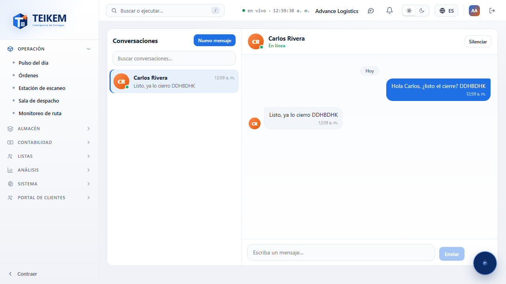
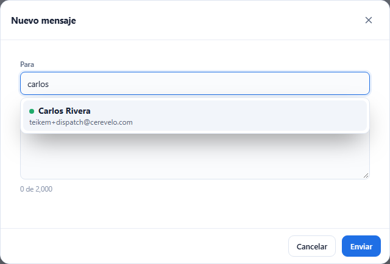
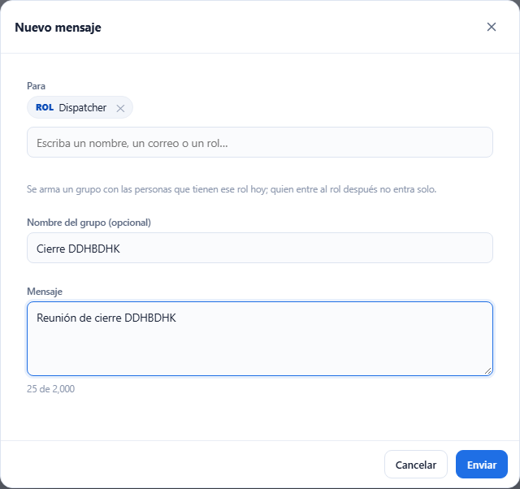
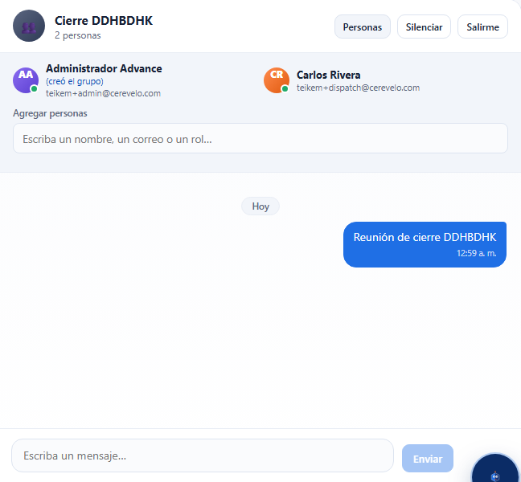
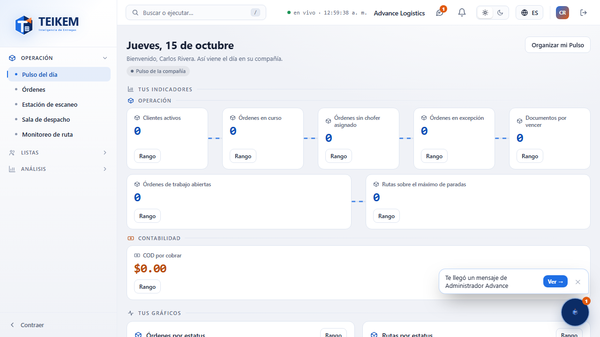

# L53 — Mensajes

La pantalla de chat de Teikem. Quién la ve: quien tiene el permiso **`messages.use`** («Usar la mensajería interna»; lo traen los roles del personal, ver [capítulo 15](../15-mensajeria.md)). Se abre con el **globo de chat de la cabecera**
(junto a la campanita), con **Kemi** («Mis mensajes») o desde el aviso de Kemi «Te llegó un mensaje de…». Sin el permiso, el botón no aparece.

## 1. Lista de conversaciones (izquierda)

- Cada conversación con su **avatar** (iniciales de la persona o 👥 si es un grupo), el **punto verde** si la otra persona está **en línea** (solo en los hilos entre dos), el **último mensaje** (en grupos, con el nombre de quien lo escribió; «Tú:» si fue usted),
  la hora (o la fecha si no es de hoy) y el **número de mensajes sin leer**; 🔕 si la silenció. La más reciente arriba.
- **Buscar conversaciones…** filtra por nombre o por el último mensaje. **Nuevo mensaje** abre la ventana de abajo.

## 2. La conversación (derecha)

- **Cabecera**: la persona (con «En línea» o «Visto hace…») o el grupo (con cuántas personas), y los botones **Personas** (en grupos), **Silenciar / Dejar de silenciar** y **Salirme** (en grupos; pide confirmación).
- **Mensajes** en burbujas: **los suyos a la derecha** (azul) y los de la otra persona a la izquierda, con la hora y separadores **Hoy / Ayer / fecha**; los seguidos de la misma persona se juntan. En un grupo, cada persona lleva su nombre.
- **Cargar mensajes anteriores** trae los más viejos (de 50 en 50).
- **Escribir**: la caja de abajo; **Enter envía**, **Mayús+Enter** salta de línea; no envía vacío. Si falla el envío, **no se pierde lo escrito**.
- Todo llega **en el momento**; si usted tiene la conversación abierta, lo nuevo se marca leído solo.
- **Personas** (grupos): lista con su presencia, quién creó el grupo y, **solo para quien lo creó**, **Agregar personas** con el buscador (nombre y correo).

## 3. Nuevo mensaje

- **Para**: un solo campo de búsqueda. Escriba parte del **nombre**, del **correo** o del **rol** y el buscador lista, a la vez, a las **personas** (con su nombre, su correo y su punto de en línea) y a los **roles** que tienen personas activas («Rol · 3 personas»); escoja con el ratón o con las flechas y Enter.
  Puede agregar **todas las personas que quiera** (fichas con ✕): una sola abre el hilo entre dos; **dos o más arman un grupo**. Escoger un **rol** agrega a quienes lo tienen **hoy** (se arma un grupo; quien entre al rol después no entra solo); un solo rol por mensaje.
- **Nombre del grupo (opcional)**: aparece si son varias personas o un rol; vacío = el del rol o los nombres.
- **Mensaje** (hasta 2000 caracteres, con contador). **Enviar**: una sola persona abre (o vuelve a) el hilo entre dos; si algo falta o falla, el mensaje del servidor se muestra tal cual y la ventana sigue abierta.

## 4. Grupos

## 5. Kemi y los mensajes

- Cuando llega un mensaje, **Kemi parpadea** y muestra el globo **«Te llegó un mensaje de Ana → Ver»** (**Ver** abre ese hilo). Silenciado, o con Kemi dormida, no hay globo (el contador de la cabecera sigue).
- En las **opciones de Kemi** (un clic en ella): **Enviar un mensaje a…** (abre «Nuevo mensaje») y **Mis mensajes** (con el contador).

## 6. En teléfono

De 360 px en adelante, sin scroll horizontal de página: se ve **una cosa a la vez**: la lista o la conversación (con **←** para volver a la lista).
