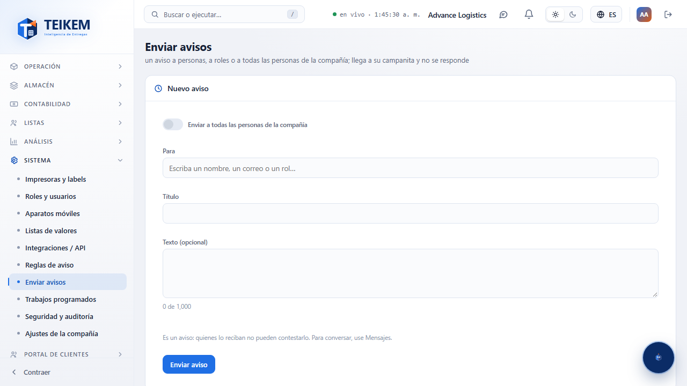
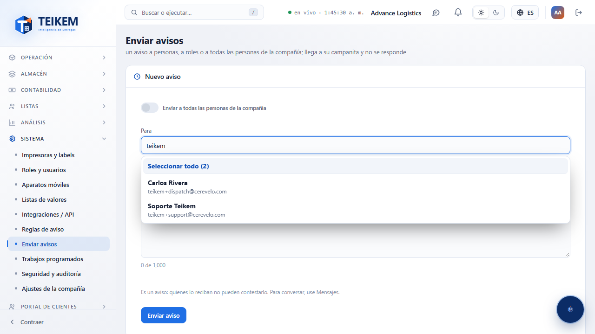
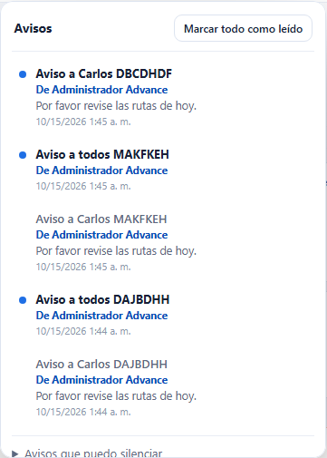

# L54 — Enviar avisos

**Sistema → Enviar avisos** (`/system/announcements`). Quién la ve: quien tiene el permiso **`notifications.send`** («Enviar avisos a otras personas»). Lo trae el rol **Admin de compañía**; **no se da a otros roles por omisión**: el administrador se lo asigna a
quien quiera (Sistema → Roles y usuarios). Módulo Sistema (siempre encendido). Sin el permiso, la entrada no aparece en el menú y el API responde 403.

Un **aviso** es distinto de un **mensaje**: un aviso **no se responde**. Llega a la **campanita** de cada persona («De Ana Rivera»), al instante si tiene Teikem abierto y, si no, queda pendiente hasta que entre. Para conversar, use [Mensajes](l53-mensajes.md).

## 1. Nuevo aviso

- **Enviar a todas las personas de la compañía**: el interruptor manda el aviso a **todas las personas activas** (menos a usted). Dice cuántas son y, al enviar, **pide confirmación** con esa cantidad.
- **Para**: un solo campo de búsqueda para **personas y roles**. Escriba parte del **nombre**, del **correo** o del **rol**; la lista muestra a las personas con su nombre y correo y a los roles con cuántas personas activas tienen («Rol · 3 personas»; los roles vacíos no salen). Escoja con el ratón o con las flechas y Enter.
  Puede escoger **varias personas y varios roles**; cada uno queda como una ficha con su ✕ (se muestran 10 fichas y un resumen del resto) y **Quitar todo** vacía la selección.
- **Seleccionar todo (N)**: la primera fila de la lista. Escoge **todas las personas y roles que coinciden con lo escrito** (los N, aunque la lista solo muestre 8) y **nada más**: si escribió «operador», marca a los operadores; si no escribió nada, marca a todos.
  La búsqueda trae hasta 500 personas; si hay más, afine lo escrito. Un rol escogido avisa a quienes lo tienen **hoy**.
- **Título** (obligatorio, hasta 150 caracteres) y **Texto** (opcional, hasta 1000, con contador).
- **Enviar aviso**. Sin repetir: quien está por persona y por rol recibe uno solo, y **usted nunca se avisa a sí mismo**. Al terminar dice a cuántas personas llegó y el formulario queda limpio.

## 2. Lo que ve quien lo recibe

En su campanita: el aviso con el **título**, el texto y **«De Ana Rivera»**; el contador sube y, si tiene Teikem abierto, **Kemi** parpadea con «Te llegó un aviso → Ver». No hay cómo contestarlo; los avisos manuales **no se silencian**.

## 3. Avisos enviados (historial)

Tabla con **cuándo**, el **aviso** (título y texto), **para quién** (a todas, o «Gerencia, Ana Rivera, +2»), **cuántas personas** lo recibieron, **cuántas lo han leído** («2 de 5») y **quién lo envió**. Más reciente primero, paginada, con **Exportar** (todo el historial). Los avisos enviados **no se editan ni se borran**.

En «Nuevo mensaje» (Mensajes) el mismo campo «Para» también tiene **Seleccionar todo**, que agrega a las personas que coinciden con lo escrito (los roles se escogen de uno en uno).

Funciona de 360 px en adelante, sin scroll horizontal de página.
