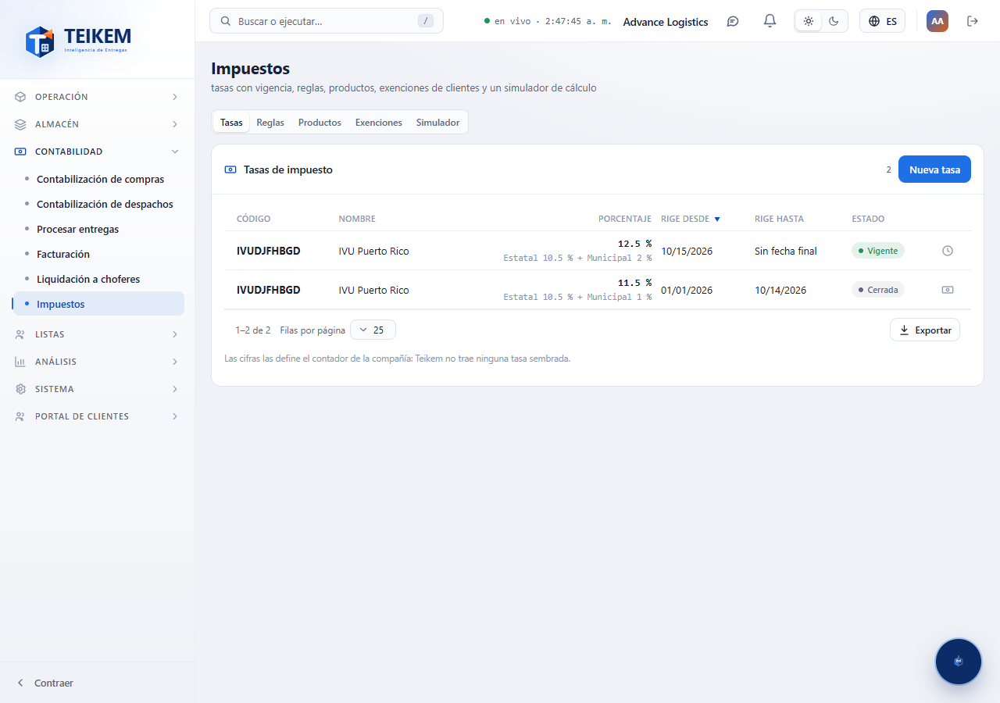
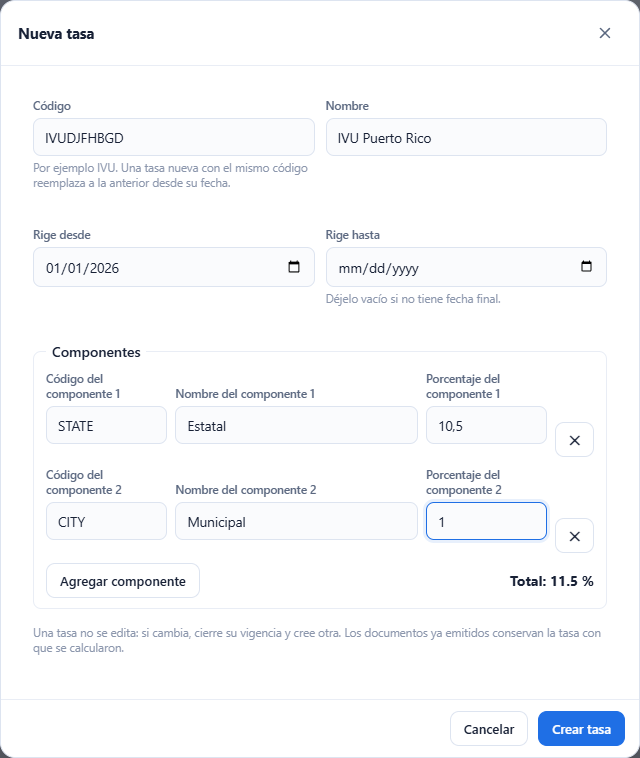
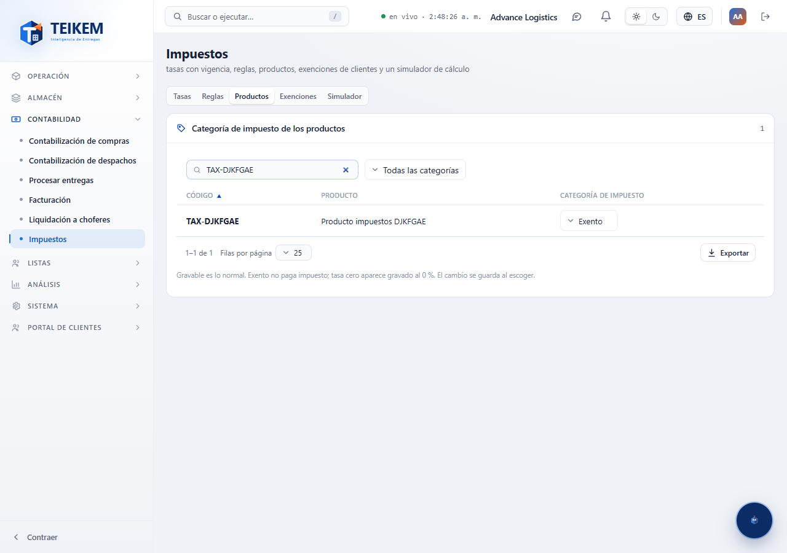
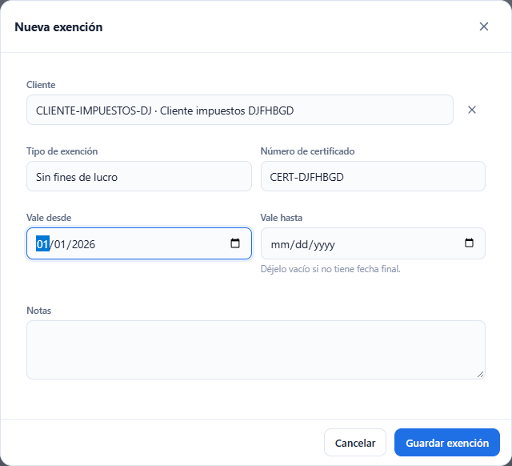
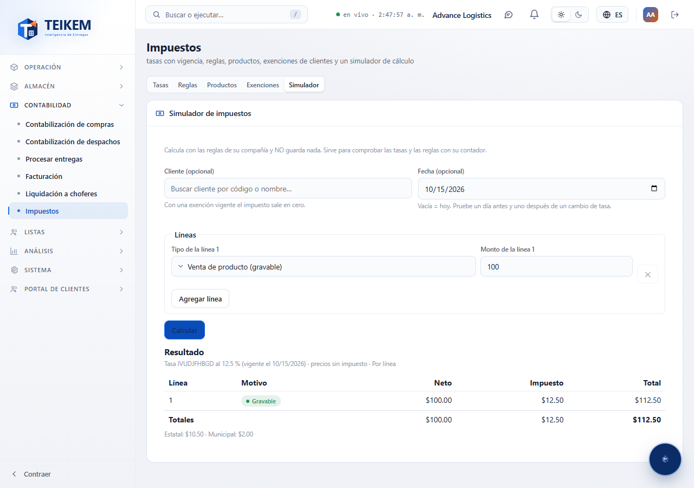

# L56 — Impuestos

**Contabilidad → Impuestos** (`/money/tax`). Quién la ve: quien tiene el permiso **`tax.manage`** («Administrar impuestos (tasas, exenciones)»; lo trae el rol **Admin de compañía**) y la compañía con el módulo **Impuestos** encendido (viene apagado: Sistema → Módulos). Sin eso, la entrada no aparece en el menú y el API responde 403.

Teikem trae el **mecanismo** y la compañía lo **configura**: ninguna tasa ni regla está fija en el programa y no viene ninguna sembrada. Las cifras (tasas, componentes, qué es gravable) las define el contador de la compañía. El resto del personal solo ve el **resultado** del impuesto en la orden y en la factura.

La pantalla tiene cinco pestañas: **Tasas**, **Reglas**, **Productos**, **Exenciones** y **Simulador**.

## 1. Tasas

Una tabla con **código**, **nombre**, **porcentaje** (con sus componentes debajo, p. ej. «Estatal 10.5 % + Municipal 1 %»), **rige desde**, **rige hasta** y **estado**: **Vigente** (rige hoy), **Programada** (empieza después) o **Cerrada**. Se ve todo el historial y se exporta completo.

**Una tasa no se edita.** Si cambia (por ejemplo, el 15 de octubre sube de 11.5 % a 12.5 %):
1. En la fila de la tasa vieja, **Cerrar vigencia** (reloj) y escriba el **último día** en que rige (14 de octubre).
2. En esa misma fila, **Nueva tasa desde esta** (ícono de dinero): trae el mismo código, nombre y componentes, y propone empezar el día siguiente (15 de octubre). Cambie el porcentaje de los componentes y **Crear tasa**.

Los documentos ya emitidos conservan la tasa con que se calcularon. Para un mismo código **las vigencias no se pueden traslapar** («Ya hay una tasa con ese código que cubre esas fechas. Cierre la vigencia de la anterior primero.»).

**Nueva tasa**: código (letras, números, guion; se guarda en mayúsculas), nombre, **rige desde**, **rige hasta** (vacío = sin fecha final) y uno o más **componentes** (código, nombre, porcentaje; **Agregar componente**). El **total** de los componentes es el porcentaje de la tasa y se ve mientras escribe; no puede pasar de 100 %.

## 2. Reglas

Una sola configuración por compañía (se crea sola con valores por omisión: precios sin impuesto incluido, redondeo por línea, ningún cargo gravable).

- **Tasa por omisión**: el código de la tasa que se usa en lo gravable; se toma la que esté vigente en la fecha del documento.
- **Los precios ya incluyen el impuesto**: activo, el monto de cada línea trae el impuesto y se extrae (111.50 con 11.5 % = 100.00 + 11.50); apagado, se suma encima.
- **Redondeo**: **por línea** (el impuesto de cada línea se redondea a centavos y se suma) o **por documento** (se suma sin redondear y se redondea una sola vez; puede diferir un centavo).
- **Cargos que pagan impuesto**: un interruptor por tipo de cargo (flete, manejo, recargo, recogido). La **venta de producto** la decide la categoría del producto.

## 3. Productos

La **categoría de impuesto** de cada producto: **Gravable** (lo normal), **Exento** (no paga) o **Tasa cero** (aparece gravado al 0 %). Se cambia con la lista de la fila y **se guarda al escoger**. Buscador por código, nombre o código de barras y filtro por categoría; trae hasta 500 productos (se afina con el buscador).

## 4. Exenciones

Los certificados de exención de los clientes: **cliente**, **tipo** (p. ej. «Sin fines de lucro»), **número de certificado**, **vale desde / hasta** (vacío = sin fecha final) y notas. Estado: **Vigente**, **Programada**, **Vencida** o **De baja**.

- Con una exención **vigente** nada se le cobra de impuesto a ese cliente y la línea queda marcada como exenta con el **certificado anotado**.
- Con la exención **vencida** se cobra el impuesto y el cálculo **avisa** qué certificado venció.
- Nunca se borran: **Dar de baja** y **Reactivar** (ícono de la fila); **Editar** cambia el tipo, el certificado, las fechas y las notas (el cliente no se cambia).

## 5. Simulador

Calcula el impuesto de unas líneas **con las reglas de la compañía y sin guardar nada**. Es el mismo cálculo que usarán las órdenes de venta y la factura: sirve para comprobar con el contador que las tasas y las reglas están bien. Se escoge un **cliente** (opcional: con exención vigente el impuesto sale en cero), una **fecha** (vacía = hoy; pruebe el día antes y el día después de un cambio de tasa) y las **líneas** (tipo —venta de producto gravable o un tipo de cargo— y monto).

El resultado dice la **tasa usada** y su vigencia, el **motivo** de cada línea (Gravable, Tasa cero, Producto exento, Cliente exento —con el certificado—, Cargo no gravable), el neto, el impuesto y el total por línea, los totales, el impuesto **por componente** y los avisos (por ejemplo, una exención vencida).

Funciona de 360 px en adelante, sin scroll horizontal de página. Los mensajes de error exactos están en el [capítulo 17](../17-impuestos.md) y en las preguntas frecuentes.
