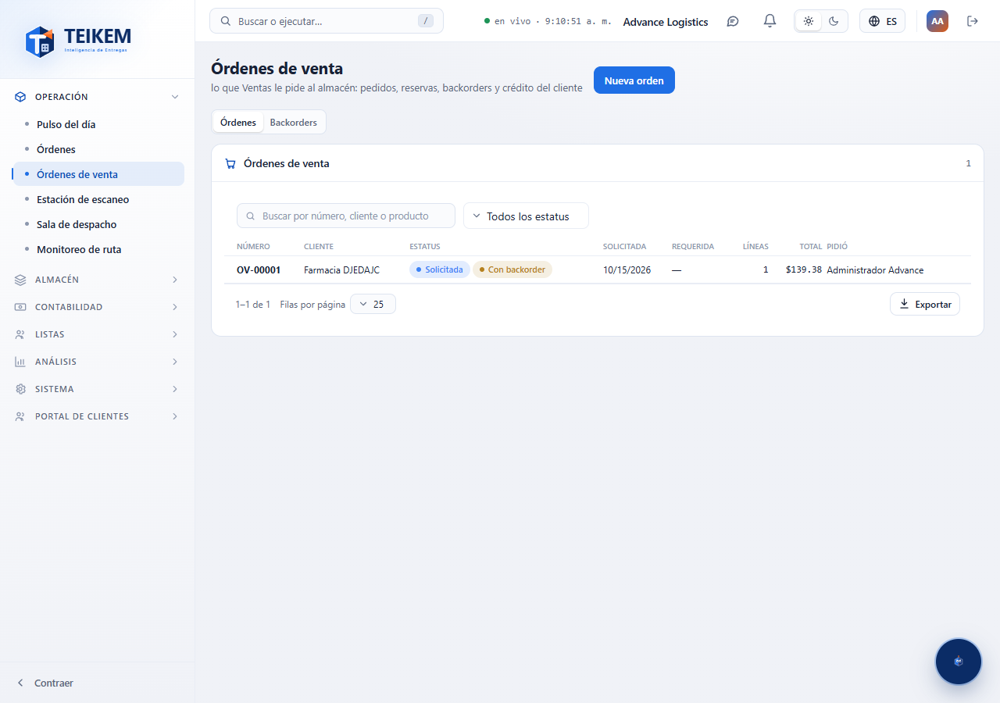
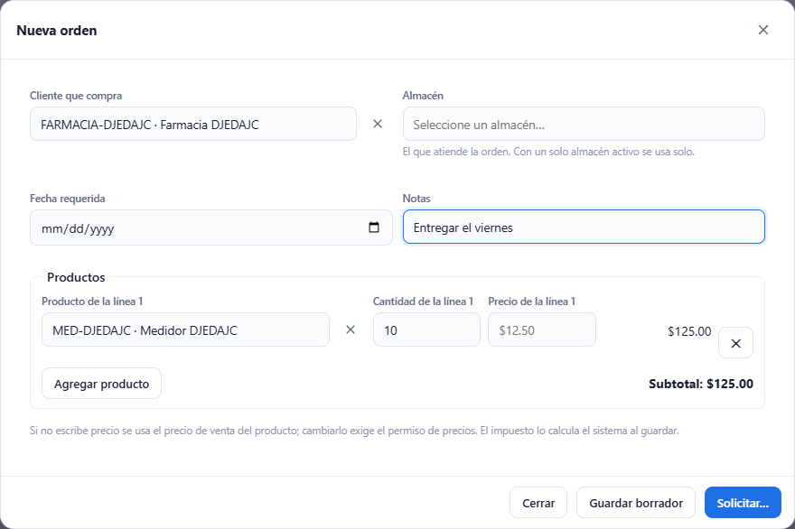
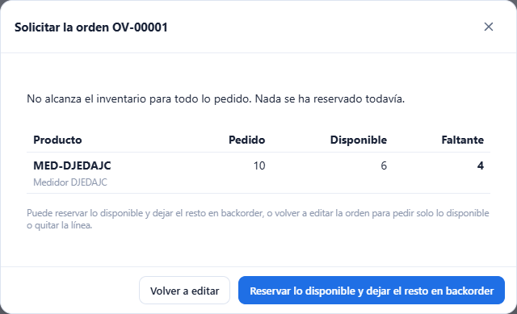
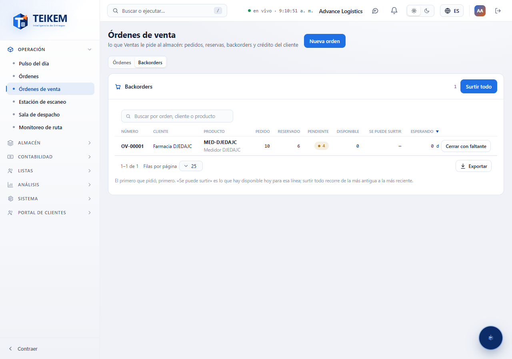

# L60 — Órdenes de venta

**Operación → Órdenes de venta** (`/sales-orders`). Quién la ve: quien tiene el permiso **`sales.view`** (Admin de compañía, rol **Ventas** y Operador de almacén) y la compañía con el módulo **Órdenes de venta** encendido (viene apagado: Sistema → Módulos). Sin eso, la entrada no aparece en el menú y el API responde 403.

Una **orden de venta** es el documento que viaja de **Ventas a Almacén**: Ventas le pide al almacén que despache algo para un cliente. Las reglas completas y los mensajes de error están en el [capítulo 18](../18-ordenes-de-venta.md). Esta pantalla cubre la parte S1: armar la orden, solicitarla (reservar el inventario), los backorders y cancelar o modificar. El despacho contra la orden llega en el lote siguiente.

La pantalla tiene dos pestañas: **Órdenes** y **Backorders**.

## 1. Órdenes

Lista paginada (la más reciente primero) con **número**, **cliente**, **estatus** (Borrador, Solicitada, Despachada parcial, Despachada, Cancelada, con la marca **Con backorder** si alguna línea tiene pendiente), fecha de solicitud, fecha requerida, líneas, **total** y quién la pidió. Buscador por **número, cliente o producto**, filtro de **estatus** y **Exportar** (todas las filas del filtro). Un clic en la fila abre la orden.

## 2. Nueva orden y borrador

**Nueva orden** (permiso `sales.create`) abre la ventana de un borrador:

- **Cliente que compra** (obligatorio, activo) y **Almacén** (si la compañía tiene uno solo activo se usa solo).
- **Fecha requerida** y **Notas** (hasta 500 caracteres).
- **Productos**: por línea, el **producto** (solo productos propios de la compañía, con buscador por código o nombre), la **cantidad** (hasta 3 decimales) y el **precio**. Si no escribe precio se usa el **precio de venta** del producto (aparece como pista en gris); escribir otro precio exige el permiso `sales.price`. Cada línea muestra su importe y abajo el **subtotal**; el **impuesto** lo calcula el sistema al guardar (con el módulo Impuestos encendido) y queda copiado en la línea.
- **Guardar borrador** guarda sin reservar nada. Un borrador se puede reabrir, cambiar (las líneas se reemplazan) o **Cancelar orden**.

## 3. Solicitar: comprobar, faltante y crédito

**Solicitar…** guarda el borrador y **comprueba antes de reservar**: abre un diálogo con el resultado.

- **Alcanza todo**: dice que hay inventario para todo y el crédito del cliente alcanza; **Solicitar y reservar** reserva en el acto (el inventario queda para esa orden y el almacén la ve).
- **Falta inventario**: la tabla muestra por producto **Pedido / Disponible / Faltante** («disponible» es lo vendible: sin cuarentena, cruce de muelle ni renta, ni lo ya reservado). **Nada se ha reservado todavía.** Puede **Reservar lo disponible y dejar el resto en backorder**, o **Volver a editar** la orden para pedir solo lo disponible o quitar la línea.
- **Crédito excedido**: el diálogo avisa con las cifras (límite, en curso, esta orden). Quien tiene el permiso **Autorizar órdenes sobre el límite de crédito** puede activar **Autorizar el crédito excedido** y solicitarla; queda anotado quién lo autorizó. Sin ese permiso no se puede solicitar.

## 4. Orden solicitada

Al abrir una orden solicitada se ve el estatus, el cliente, el almacén, quién la pidió y cuándo, las notas y las líneas con **Pedido / Reservado / Backorder / Despachado / Precio / Impuesto / Importe**, y los totales.

- **Cambiar cantidad** (`sales.create`): en una línea sin nada despachado. Subir reserva más (si no alcanza avisa; con **dejar el resto en backorder** reserva lo que haya); bajar quita primero del backorder y luego libera reserva. El impuesto y los totales se recalculan.
- **Surtir** y **Cerrar con faltante** (`sales.backorder`): en líneas con backorder (ver sección 5).
- **Cancelar orden** (`sales.cancel`): libera **exactamente lo que tenía reservado** y borra su backorder. Una orden con algo ya despachado no se cancela.

## 5. Backorders

Todas las líneas con pendiente de las órdenes solicitadas, **la más antigua primero** («el primero que pidió, primero»): orden, cliente, producto, **pedido / reservado / pendiente**, lo **disponible hoy**, lo que **se puede surtir ahora** (verde) y cuánto lleva esperando. Buscador por orden, cliente o producto.

- **Surtir** (en la fila; `sales.backorder`) reserva para la línea lo que haya, todo o parte.
- **Surtir todo** (arriba) recorre los backorders **de la más antigua a la más reciente** y surte lo que se pueda; el aviso dice cuántas unidades se reservaron y en cuántas líneas. Una línea completa **sale de la vista**.
- **Cerrar con faltante** da la línea por terminada sin esperar más inventario; lo ya reservado se despacha igual.

Funciona de 360 px en adelante, sin scroll horizontal de página.
