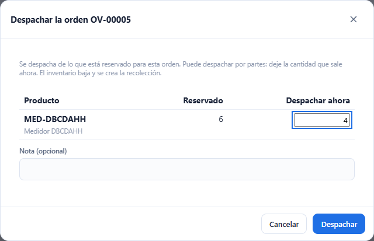
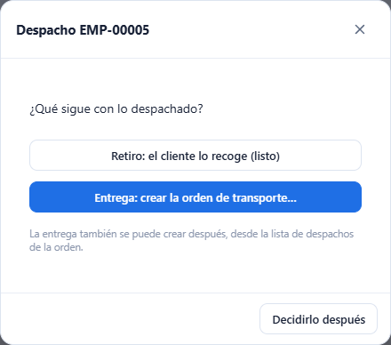
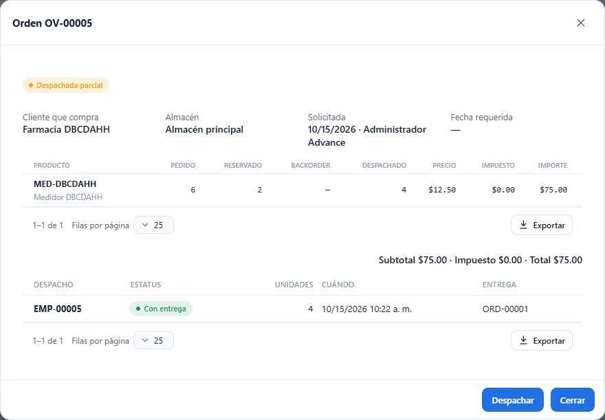

# L63 — Despachar contra una orden de venta (web)

Desde la ventana de una orden **solicitada** (Operación → [Órdenes de venta](l60-ordenes-de-venta.md)) se despacha lo reservado, se decide qué sigue (retiro o entrega) y se ve la lista de **despachos** de la orden. Las reglas completas y los mensajes de error están en el [capítulo 18](../18-ordenes-de-venta.md), secciones 10 y 11. Hace falta el permiso **`warehouse.pick`** (el mismo de recolectar); crear la entrega pide además `orders.create`.

## 1. Despachar

En la orden, **Despachar** (aparece mientras quede algo reservado). La ventana muestra por línea lo **reservado** y la cantidad que sale **ahora** (por omisión, todo lo reservado). Se puede despachar **por partes**: baje la cantidad de una línea o deje en cero las que no salen hoy. Hay una nota opcional.

- No se puede despachar más de lo reservado («No se puede despachar más de lo reservado: XXX tiene n reservadas.»).
- Al confirmar, **el inventario baja** (siempre, lo entreguen o lo vengan a recoger), se crea la recolección (`EMP-#####`) enlazada a la orden y se consume la reserva.
- El sistema usa las posiciones y lotes que reservó. Si el producto está en otra posición, eso se hace con el **aparato** (que guía por posición y permite tomar de otra); la reserva se mueve sola.

## 2. ¿Qué sigue con lo despachado?

Al terminar sale una pregunta:

- **Retiro: el cliente lo recoge (listo)**: no hace falta nada más; el despacho queda como «Despachado» (sin entrega).
- **Entrega: crear la orden de transporte…**: abre el formulario del empaque (servicio, consignatario, paquetes, COD…), con el **cliente y el consignatario de la orden de venta ya puestos** (o un consignatario nuevo). Crea la orden de transporte real y el despacho pasa a «Con entrega».
- **Decidirlo después**: la entrega se puede crear luego desde la lista de despachos.

## 3. Despachos de la orden

Debajo de las líneas, la tabla de **despachos**: número de la recolección, estatus (**Despachado**, **Con entrega**, **Deshecho**), unidades, cuándo y la **orden de transporte** de la entrega (si la tiene). **Crear entrega** aparece en los despachos sin entrega.

El estatus de la orden sigue lo despachado: **Despachada parcial** mientras quede algo reservado o en backorder y **Despachada** cuando todo salió (o se cerró con faltante). Si se **deshace** un despacho (eliminando su recolección), la existencia vuelve, baja lo despachado y se vuelve a reservar, y la orden se reabre.

Funciona de 360 px en adelante, sin scroll horizontal de página.
