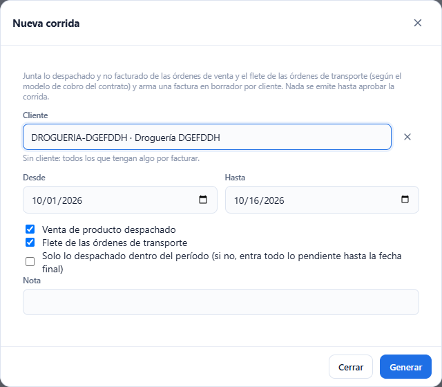
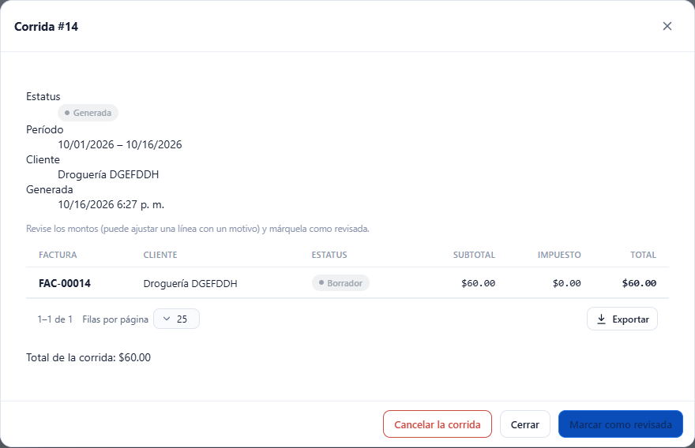
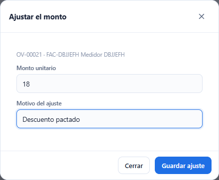
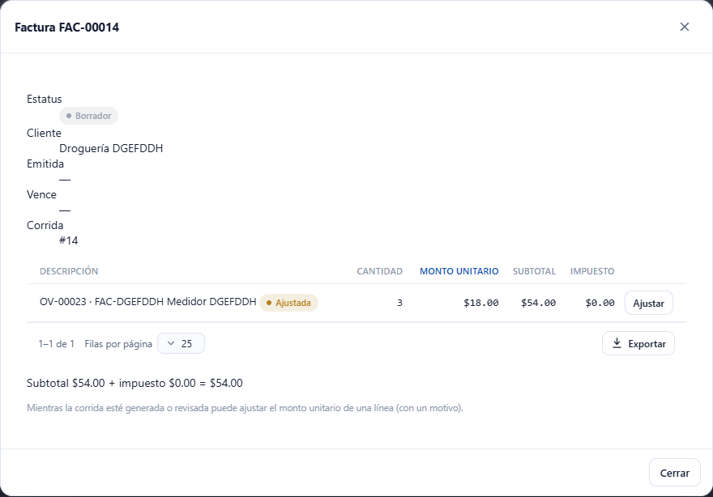
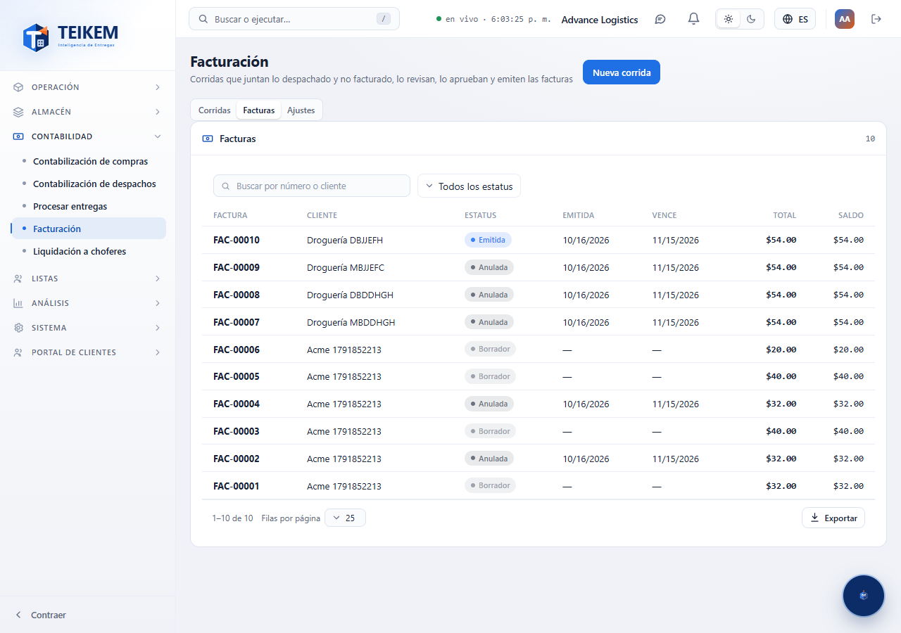
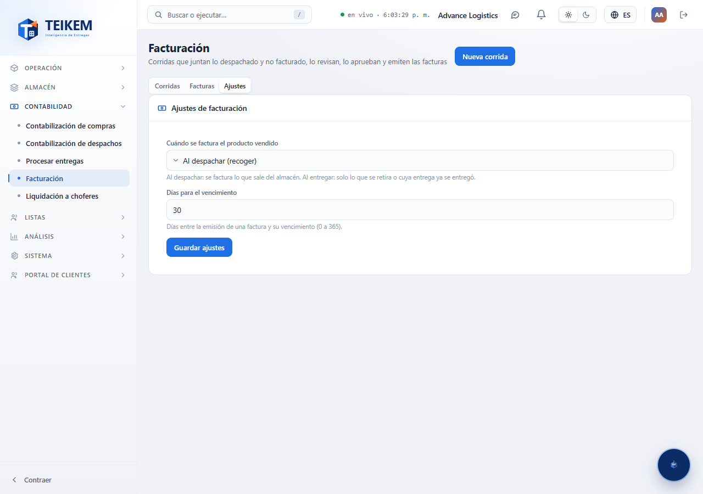

# L73 — Facturación

**Dinero → Facturación** (`/money/billing`). La ve quien tiene el permiso **`billing.view`** y la compañía con el módulo **Facturación** (`BILLING`) encendido. Las reglas completas y los mensajes de error están en el [capítulo 19](../19-facturacion.md).

Una **corrida** junta lo despachado y no facturado de las órdenes de venta, arma una factura en borrador por cliente, se revisa, se aprueba (emite las facturas) y, si hace falta, se cancela o se anula una factura. La pantalla tiene tres pestañas: **Corridas**, **Facturas** y **Ajustes**.

## 1. Nueva corrida

**Nueva corrida** (permiso `billing.generate`) pide el **cliente** (opcional: sin cliente entran todos los que tengan algo por facturar), el período **Desde / Hasta**, **qué facturar** (casillas *Venta de producto despachado* y *Flete de los envíos de transporte*, ambas marcadas por omisión; al menos una, Lote 74), si cuenta **solo lo despachado dentro del período** y una **nota**. Valida antes de enviar: las dos fechas, la final no anterior a la inicial y la nota de hasta 500 caracteres. **Generar** abre la corrida.

## 2. La corrida

Muestra el estatus (Generada → Revisada → Aprobada, o Cancelada), el período, el cliente y las facturas con su subtotal, impuesto y total. Según el estatus:

- **Generada / Revisada**: se pueden ajustar las líneas y **Cancelar la corrida** (anula sus facturas y lo reclamado vuelve a quedar por facturar).
- **Generada**: **Marcar como revisada**.
- **Revisada**: **Aprobar y emitir** (`billing.approve`, pide **reautenticación**: aparece la ventana «Confirme su identidad»).

## 3. Factura y ajuste de una línea

Al abrir una factura se ven sus líneas (orden de venta, producto, cantidad, monto unitario, subtotal e impuesto) y los totales. Mientras la corrida esté generada o revisada, **Ajustar** cambia el **monto unitario** (hasta 4 decimales) y exige el **motivo** (hasta 250 caracteres); la línea queda marcada **Ajustada** y el impuesto se recalcula.

## 4. Facturas y anular

La pestaña **Facturas** lista todas con buscador (número o cliente) y filtro por estatus (Borrador, Emitida, Pagada, Vencida, Anulada). Una factura **Emitida** o **Vencida** se anula con **Anular la factura** (`billing.approve`, reautenticación; motivo opcional): lo que había facturado vuelve a quedar por facturar. El servidor rechaza anular una factura con pagos.

## 5. Ajustes

Quien tiene `billing.approve` elige **cuándo se factura el producto vendido** (al despachar o al entregar) y los **días para el vencimiento** (0 a 365). Los demás los ven sin poder cambiarlos.

## Móvil

Desde 360 px las tablas pasan a tarjetas y las ventanas ocupan el ancho; no hay scroll horizontal de página.
