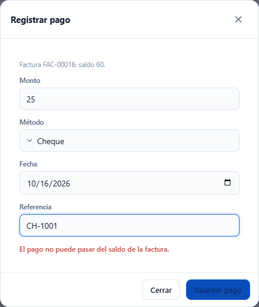
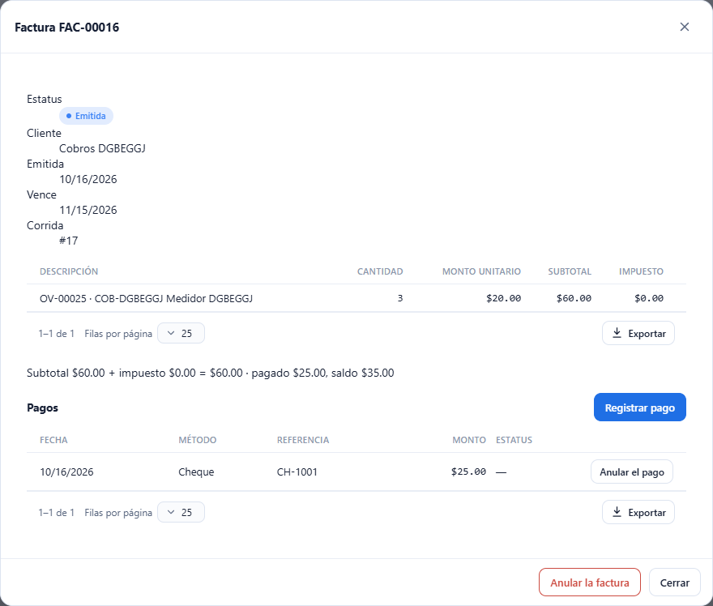
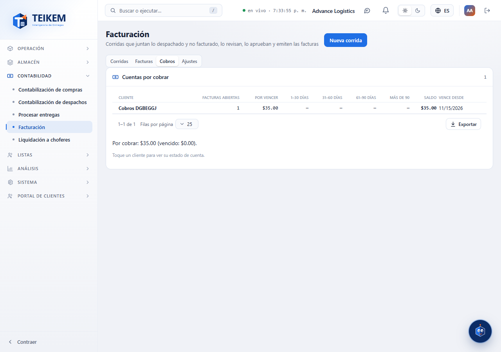

# L76 — Cobros: pagos, cuentas por cobrar y estado de cuenta

**Contabilidad → Facturación** (`/money/billing`), la pestaña **Cobros** y la ficha de cada factura. Las reglas completas y los mensajes de error están en el [capítulo 19 §4b](../19-facturacion.md).

## 1. Pagos de una factura

En la ficha de una factura (pestaña **Facturas**, un clic en la fila), debajo de los totales, la sección **Pagos** lista cada pago con **fecha, método, referencia y monto**; un pago anulado sale tachado con el estatus **Anulado** (el motivo en el texto flotante).

- **Registrar pago** (permiso `billing.generate`; solo en una factura **Emitida o Vencida**): monto (por omisión, el saldo), **método** (Cheque, ACH, Tarjeta o Efectivo), **fecha** (hoy por omisión; no futura ni anterior a la emisión) y **referencia** (cheque o confirmación, hasta 80 caracteres). La pantalla avisa antes de enviar si el monto está vacío, tiene más de 2 decimales o **pasa del saldo**; el resto de los mensajes los da el servidor. Cuando lo pagado cubre el total, la factura pasa a **Pagada**.

- **Anular el pago** (permiso `billing.approve` y **reautenticación**; solo si la factura no está Pagada): pide el **motivo** (obligatorio, hasta 250 caracteres). El pago deja de contar en el saldo.

## 2. Cobros: cuentas por cobrar

La pestaña **Cobros** lista, por cliente, las **facturas abiertas**, el **saldo** y su **antigüedad** en cinco columnas (por vencer, 1–30, 31–60, 61–90 y más de 90 días), con la fecha de vencimiento más antigua; de mayor a menor saldo. Debajo, el total por cobrar y cuánto de eso está vencido. La tabla se ordena y se exporta como las demás. Un clic en un cliente abre su estado de cuenta.

## 3. Estado de cuenta

La ventana **Estado de cuenta · cliente** trae el rango **Desde / Hasta** (por omisión, los últimos 90 días), el **saldo inicial** (lo anterior al período), lo **facturado**, lo **pagado** y el **saldo final**; la tabla de **movimientos** (las facturas emitidas como cargos y los pagos como pagos, con el saldo corrido) y la **antigüedad** de lo abierto hoy. Un clic en un movimiento abre su factura (para registrar el pago de lo que falta).

## Móvil

Desde 360 px las tablas pasan a tarjetas y las ventanas ocupan el ancho; no hay scroll horizontal de página.
