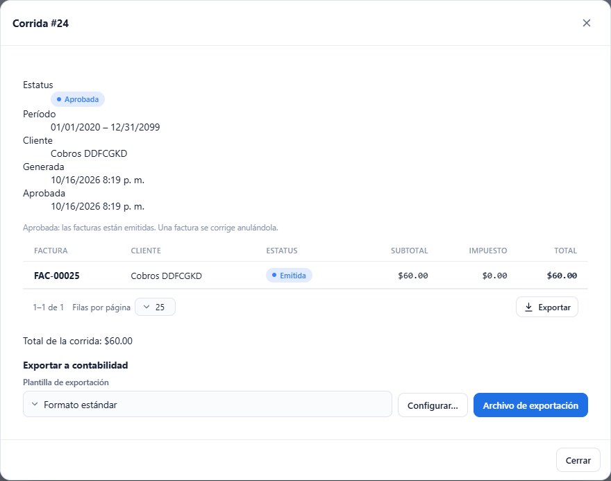
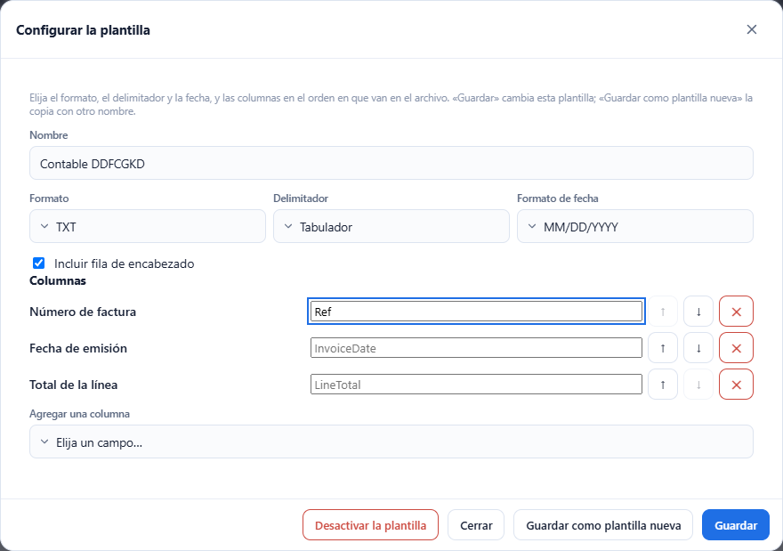
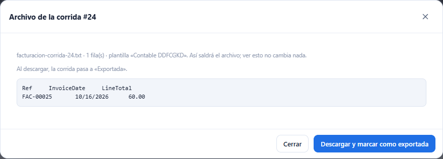

# L78 — Exportar a contabilidad

**Contabilidad → Facturación → Corridas**, dentro de una corrida **Aprobada o Exportada**, en la sección **Exportar a contabilidad** (solo con el permiso **`billing.export`**). Las reglas, los campos y los mensajes de error están en el [capítulo 19 §4c](../19-facturacion.md).

## 1. El selector de plantilla

Debajo de las facturas de la corrida aparece la sección con el **selector de plantilla** (la compañía arranca con **«Formato estándar»**: CSV con coma, fecha ISO, encabezado y todas las columnas) y dos botones: **Configurar…** y **Archivo de exportación**. Si la corrida ya se exportó, dice cuándo («Exportada el …») y recuerda que se puede volver a exportar con otra plantilla.

## 2. Configurar la plantilla

**Configurar…** abre el editor de la plantilla elegida:

- **Nombre** (hasta 80 caracteres), **Formato** (CSV o TXT), **Delimitador** (coma, punto y coma, tabulador o barra vertical), **Formato de fecha** (`YYYY-MM-DD`, `MM/DD/YYYY` o `DD/MM/YYYY`) e **Incluir fila de encabezado**.
- **Columnas**: la lista en el orden en que van en el archivo. Cada una trae su **encabezado propio** (opcional; el texto gris es el que se usa si se deja vacío), flechas para **subir o bajar** y ✕ para **quitarla**; **Agregar una columna** ofrece los campos del catálogo que faltan.
- **Guardar** cambia esta plantilla; **Guardar como plantilla nueva** la copia con el nombre que se escriba (el nombre no se repite entre las activas, sin mayúsculas ni acentos: si ya existe, el servidor lo avisa); **Desactivar la plantilla** la quita de la lista (pide confirmación y no aparece si es la única).
- La pantalla avisa antes de enviar si falta el nombre, no queda ninguna columna o un encabezado pasa de 60 caracteres.

## 3. Archivo de exportación

**Archivo de exportación** abre la **vista previa**: el archivo tal como saldrá con la plantilla elegida (nombre del archivo, cantidad de filas y el texto completo). **Ver la vista previa no cambia nada.**

- En una corrida **Aprobada**, **Descargar y marcar como exportada** baja el archivo (CSV o TXT, UTF-8) y la corrida pasa a **Exportada**, con quién y cuándo.
- En una corrida ya **Exportada**, **Descargar de nuevo** baja el archivo otra vez (con la misma u otra plantilla) sin cambiar nada más.

## Móvil

Desde 360 px las ventanas ocupan el ancho y las columnas del editor pasan el encabezado a su propia línea; no hay scroll horizontal de página.
