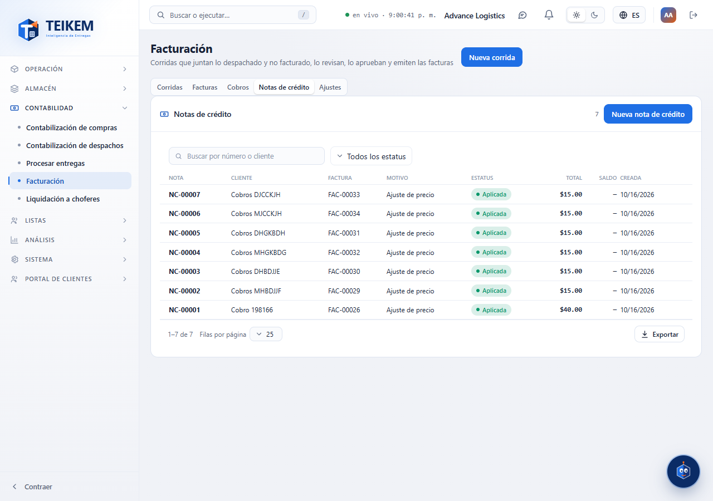
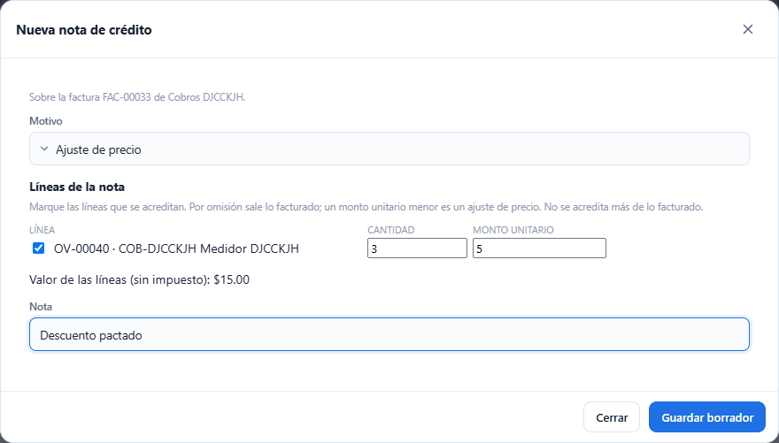
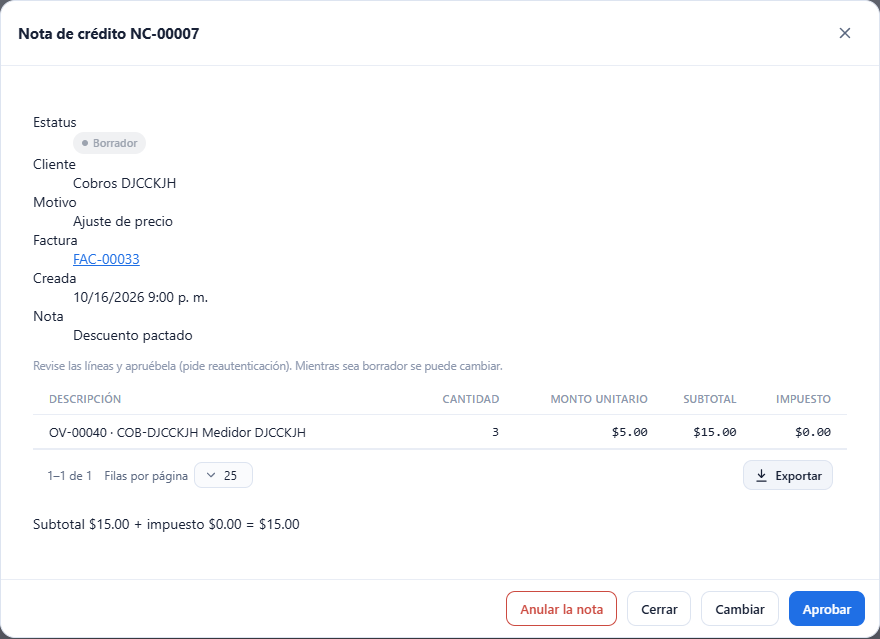

# L80 — Notas de crédito

**Contabilidad → Facturación → Notas de crédito** y la ficha de cada factura. La ven quienes tienen `billing.view`; **crear, cambiar, aplicar y anular** piden **`billing.credit`** y **aprobar** pide además **reautenticación**. Las reglas, los topes y los mensajes de error están en el [capítulo 19 §4d](../19-facturacion.md).

## 1. La lista

La pestaña **Notas de crédito** lista cada nota con su **número (NC-#####)**, cliente, factura, **motivo**, estatus (Borrador, Aprobada, Aplicada, Anulada), total, **saldo** (lo aprobado que falta por aplicar) y fecha. Tiene buscador (número o cliente), filtro por estatus, orden por columna y exportación como las demás tablas. Un clic abre la ficha.

## 2. Crear una nota

**Nueva nota de crédito** (o **Crear nota de crédito** en la ficha de una factura emitida, vencida o pagada, que ya trae la factura):

- **Sobre una factura:** se elige la factura (buscador por número o cliente) y salen sus líneas, todas marcadas, con la **cantidad y el monto unitario facturados**. Se desmarcan las que no se acreditan y se baja el monto unitario para un **ajuste de precio**. El valor estimado de las líneas se ve abajo (el impuesto lo calcula el servidor con el de la factura). **No se acredita más de lo facturado** ni de lo que ya acreditan otras notas aprobadas: el servidor lo avisa.
- **Libre** (factura de otro sistema o un ajuste): se elige el **cliente**, la referencia de la factura externa (opcional) y se escriben las líneas (descripción, cantidad, monto unitario y tipo de cargo: flete, recargo, manejo o recogido); el impuesto lo calcula el motor de impuestos.
- En los dos: **motivo** (devolución, ajuste de precio, falla del servicio o error de facturación; obligatorio) y una **nota** de hasta 500 caracteres. **Guardar borrador** la crea.

La pantalla avisa antes de enviar si falta el motivo, el cliente o la factura, no queda ninguna línea o una cantidad o monto no vale.

## 3. La ficha

Muestra el estatus, el cliente, el motivo, la factura (un clic la abre), las fechas, las líneas con su impuesto y los totales; si ya se aplicó algo, las **aplicaciones** (factura, fecha y monto) y «aplicado X, saldo Y». Las acciones dependen del estatus:

- **Borrador:** **Cambiar** (abre el editor con las líneas de la nota), **Aprobar** (con reautenticación) y **Anular la nota**.
- **Aprobada con saldo:** **Aplicar a una factura** y **Anular la nota** (solo si todavía no se aplicó nada).
- **Aplicada o Anulada:** solo se ve.

## 4. Aplicar a una factura

**Aplicar a una factura** lista las facturas **emitidas o vencidas con saldo del mismo cliente** y propone el **menor entre el saldo de la nota y el de la factura**. La pantalla avisa si el monto no vale, tiene más de 2 decimales o pasa de alguno de los dos saldos. Al aplicar, el saldo de la factura baja igual que con un pago (si queda en cero pasa a **Pagada**) y, cuando la nota se agota, pasa a **Aplicada**. Lo que no se aplica queda como **saldo a favor**.

## 5. En el resto de Facturación

- La **ficha de la factura** muestra lo **acreditado** junto al pago («acreditado X, saldo Y») y ofrece **Crear nota de crédito**.
- **Cobros → cuentas por cobrar** trae la columna **Saldo a favor** por cliente, y el **estado de cuenta** muestra las notas aprobadas como créditos con el saldo corrido y el **saldo a favor (sin aplicar)**.

## Móvil

Desde 360 px las tablas pasan a tarjetas y las ventanas ocupan el ancho; las líneas del editor se acomodan en dos columnas. No hay scroll horizontal de página.
