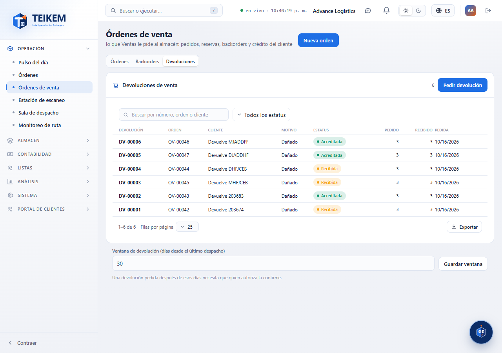
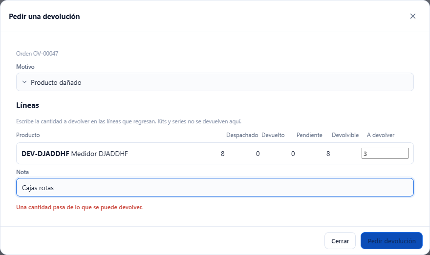
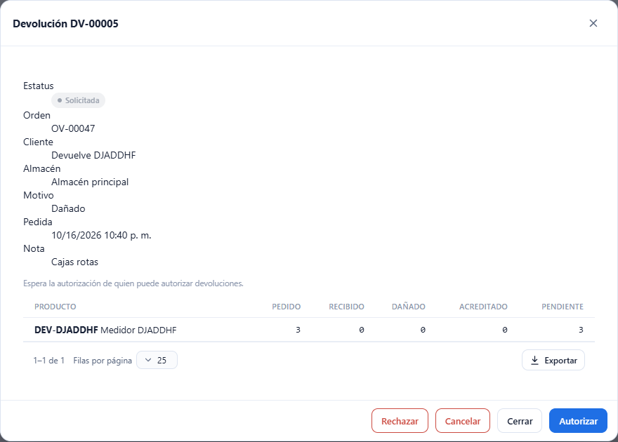
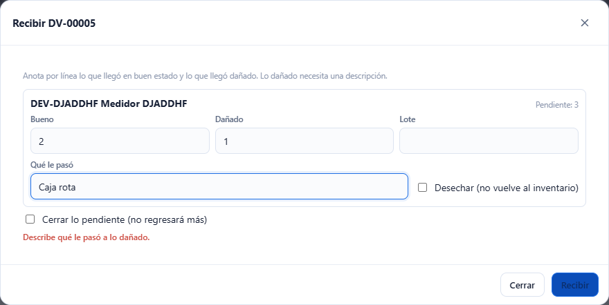
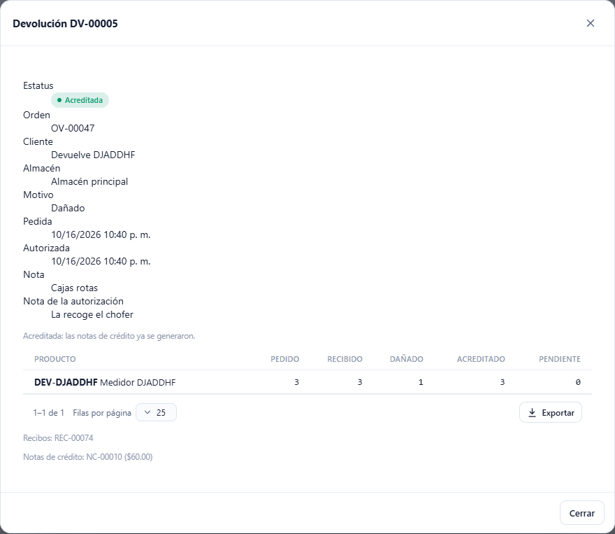

# L82 — Devoluciones de venta

**Operación → Órdenes de venta → Devoluciones** y el botón **Pedir devolución** en la ficha de una orden despachada. La ven quienes tienen `sales.view` (módulo SALES_ORDERS). **Pedir y cancelar** piden **`sales.return`**; **autorizar, rechazar y cambiar la ventana**, **`sales.return.authorize`**; **recibir**, **`warehouse.receive`**; **acreditar**, **`billing.credit`**. Las reglas, los topes y los mensajes de error están en el [capítulo 20](../20-devoluciones-de-venta.md).

## 1. La lista

La pestaña **Devoluciones** lista cada devolución con su **número (DV-#####)**, la orden, el cliente, el motivo, el estatus (Solicitada, Autorizada, Recibida, Acreditada, Rechazada, Cancelada), lo pedido y lo recibido y la fecha. Si se pidió fuera de la ventana lleva la marca **Fuera de la ventana**. Tiene buscador (número, orden o cliente), filtro por estatus, orden por columna y exportación como las demás tablas. Un clic abre la ficha.

Debajo de la tabla está la **ventana de devolución**: los días desde el último despacho en que se acepta una devolución (30 por omisión). Quien puede autorizar la cambia (entero de 0 a 3650); los demás solo la ven.

## 2. Pedir una devolución

**Pedir devolución** en la lista (se elige la orden entre las despachadas) o en la ficha de una orden con algo despachado (ya trae la orden):

- Salen las líneas con lo **despachado, devuelto, pendiente y devolvible**; se escribe la cantidad en las que regresan. **No se pasa de lo devolvible.** Los **kits** y los productos con **serie** no se devuelven aquí (la casilla sale deshabilitada).
- Se elige el **motivo** (producto dañado, producto equivocado, el cliente ya no lo necesita, vencido u otro; obligatorio) y una **nota** de hasta 500 caracteres.
- Si pasaron **más días que la ventana** desde el último despacho, la pantalla lo avisa: solo quien puede autorizar la pide, marcando **Confirmo recibirla fuera de la ventana**; los demás ven que necesita a un autorizador.

La pantalla avisa antes de enviar si falta el motivo o la orden, no hay cantidades, una cantidad no vale o pasa del tope.

## 3. La ficha y sus acciones

Muestra el estatus, la orden, el cliente, el almacén, el motivo, las fechas, las notas, una línea de ayuda de qué sigue, las líneas (pedido, recibido, dañado, acreditado y pendiente) y, cuando existen, los **recibos** y las **notas de crédito** generados.

| Estatus | Acciones |
|---|---|
| Solicitada | **Autorizar** (con una nota opcional), **Rechazar** (el motivo es obligatorio), **Cancelar** |
| Autorizada | **Recibir**, **Cancelar** (mientras no se haya recibido nada) |
| Recibida | **Recibir** (si queda algo pendiente), **Acreditar** |
| Acreditada, Rechazada, Cancelada | solo se ve |

## 4. Recibir lo bueno y lo dañado

**Recibir** abre una línea por cada producto con algo pendiente. Se anota lo que llegó **bueno**, lo que llegó **dañado** y, si hace falta, el **lote**. Lo dañado pide la descripción **Qué le pasó** y una casilla **Desechar** (no vuelve al inventario). **Cerrar lo pendiente** da por terminada la devolución aunque falte algo (no regresará más). Lo bueno entra al inventario con el recibo de tipo devolución; lo dañado queda en un reporte de daño con la causa «Devolución de cliente». La pantalla no deja enviar sin nada, con una cantidad que no vale, que pase de lo pendiente o con daño sin descripción.

## 5. Acreditar

**Acreditar** (en una devolución Recibida) crea **notas de crédito en borrador** por lo recibido y facturado; se aprueban y aplican en **Facturación → Notas de crédito**. Si lo devuelto no se había facturado, el servidor avisa que no hay nada por acreditar.

## Móvil

Desde 360 px las tablas pasan a tarjetas, las ventanas ocupan el ancho y las líneas de pedir y recibir se acomodan en una o dos columnas. No hay scroll horizontal de página.
