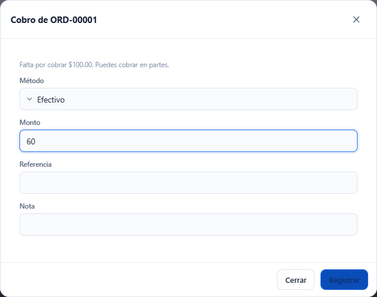
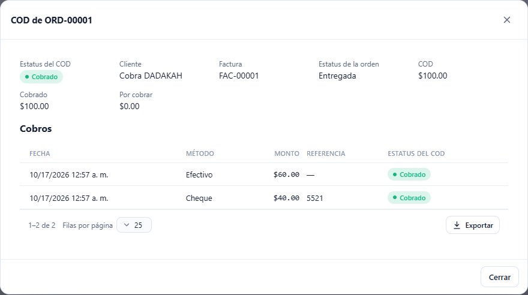
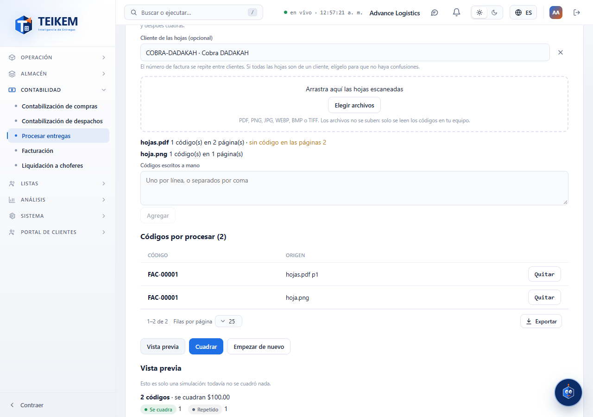
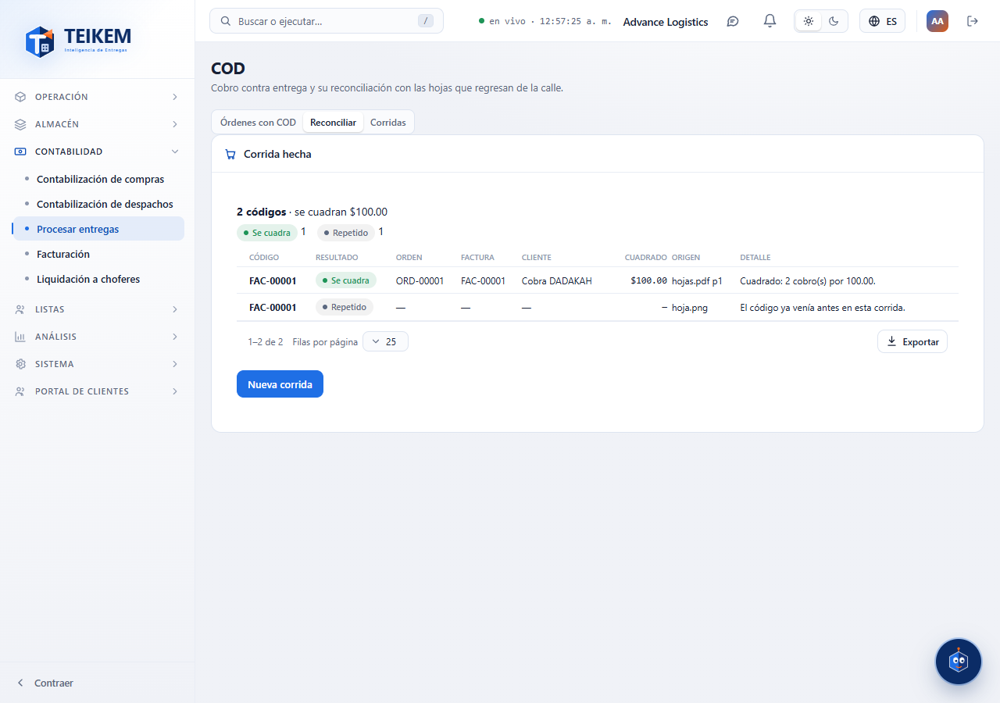

# L85 — COD: cobro y reconciliación con hojas escaneadas

**Contabilidad → Procesar entregas (COD)** (`/money/cod`). La ven quienes tienen `cod.view` (módulo COD). **Registrar cobros** pide `cod.collect` y la pestaña **Reconciliar** pide `cod.reconcile`. Las reglas y los mensajes del servidor están en el [capítulo 21](../21-cod.md).

## 1. Órdenes con COD

La pestaña **Órdenes con COD** lista cada orden con COD: orden, **factura**, cliente, estatus de la orden, **COD**, **cobrado**, **por cobrar** y el estatus del COD (Por cobrar, Parcial, Cobrado, Cuadrado, Remitido). Tiene buscador (orden, factura o cliente), filtro por estatus, orden por columna y exportación como las demás tablas. Un clic abre la ficha.

La **ficha** muestra lo pedido, lo cobrado y lo que falta, y cada cobro (fecha, método, monto, referencia y estatus). **Registrar cobro** (solo con algo por cobrar y la orden ya fuera de borrador) pide el **método** (efectivo, cheque, company check, ATH Móvil o tarjeta), el **monto** (por omisión lo que falta; se puede cobrar en partes), el **número del cheque** (solo en cheque y company check), una referencia y una nota. La pantalla avisa antes de enviar si el monto no vale o pasa de lo que falta.

## 2. Reconciliar con hojas escaneadas

La pestaña **Reconciliar** cuadra lo cobrado contra las hojas (facturas) que regresan de la calle, cuyo **código de barras es el número de la factura**:

1. **Cliente de las hojas (opcional).** El número de factura se repite entre clientes (`FAC-00001` existe en cada cliente): si todas las hojas son de un cliente, se elige y el código solo se busca entre sus órdenes. Sin cliente, un código que coincide con varias órdenes sale **Ambiguo**.
2. **Archivos.** Se arrastran o se eligen los archivos escaneados: **PDF** (se lee cada página) o imágenes (**PNG, JPG, WEBP, BMP, TIFF**). **Los archivos no se suben al servidor:** el navegador lee el código de barras en el equipo (Code 128, Code 39, EAN, ITF, QR y demás formatos comunes, también girados o invertidos) y solo los **códigos** viajan al servidor. Por cada archivo se ve el avance («leyendo la página 2 de 5…»), cuántos códigos salieron y las **páginas sin código** (para revisarlas). Un archivo que no es PDF ni imagen, o que no se puede abrir, avisa y los demás siguen.
3. **Códigos escritos a mano.** Uno por línea, o separados por coma, punto y coma o espacio; entran con el origen «Manual».
4. **Códigos por procesar.** La lista junta lo leído de los archivos (con el archivo y la página de cada uno) y lo escrito; cualquiera se puede **quitar**.
5. **Vista previa.** Dice, para cada código, qué pasaría —**Se cuadra**, Ya cuadrado, **No encontrado**, **Ambiguo**, Sin COD, **Nada cobrado** o Repetido (la misma hoja dos veces)— con la orden, la factura, el cliente, el monto y el detalle; y un resumen con el total que se cuadraría. **No cambia nada.** Si se cambia la lista o el cliente, la vista previa se descarta.
6. **Cuadrar.** Solo se habilita con una vista previa que cuadre algo; pide confirmación y deja la corrida guardada.

## 3. Corridas

La pestaña **Corridas** lista las reconciliaciones hechas (fecha, origen —los nombres de los archivos o «Manual»—, códigos, cuadrados, con problema y quién). Un clic abre el detalle con el resultado de cada código.

## Móvil

Desde 360 px las tablas pasan a tarjetas y las ventanas ocupan el ancho. En el teléfono el selector de archivos abre la cámara o la galería según el sistema. No hay scroll horizontal de página.
