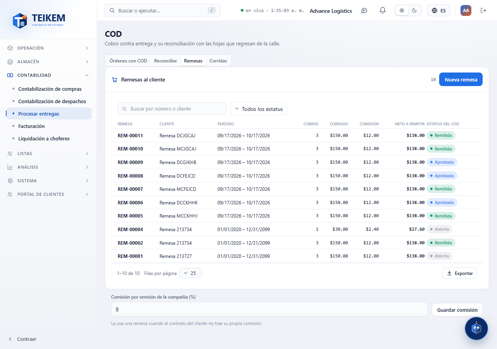
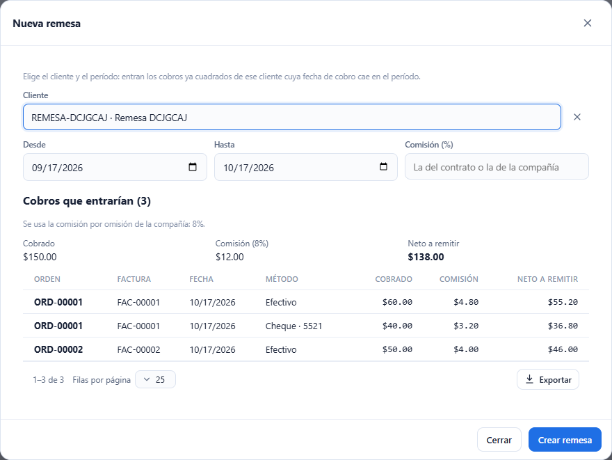
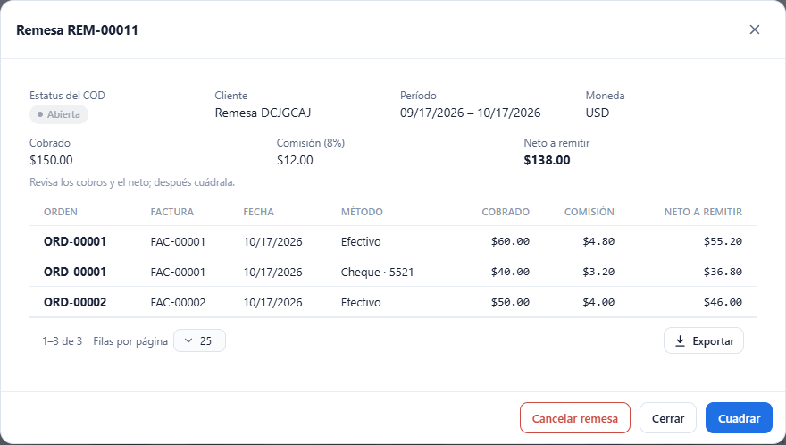
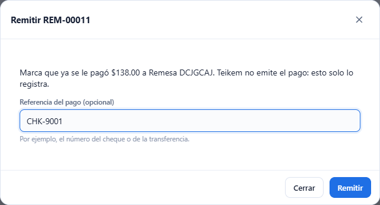

# L87 — Remesas COD al cliente

**Contabilidad → Procesar entregas (COD) → Remesas** (`/money/cod`). La pestaña la ve quien tiene `cod.view` (módulo COD); **crear, cuadrar, aprobar, remitir, cancelar, exportar y cambiar la comisión por omisión** piden **`cod.remit`**. Las reglas y los mensajes del servidor están en el [capítulo 21 §6](../21-cod.md). Teikem **calcula y exporta** la remesa; **no emite el pago**.

## 1. La lista

La pestaña **Remesas** lista cada remesa (**REM-#####**) con el cliente, el período, cuántos cobros trae, lo **cobrado**, la **comisión**, el **neto a remitir** y su estatus (Abierta, Cuadrada, Aprobada, Remitida). Tiene buscador (número o cliente), filtro por estatus, orden por columna y exportación como las demás tablas. Una remesa cancelada no sale. Debajo está la **comisión por omisión de la compañía** (8 % de fábrica): la usa una remesa cuando el contrato del cliente no trae su propia comisión; la cambia quien tiene `cod.remit` (de 0 a 100, hasta 2 decimales).

## 2. Nueva remesa

**Nueva remesa**: se elige el **cliente** y el **período** (por omisión, los últimos 30 días) y, si se quiere, una **comisión (%)** propia para esta remesa. Sin esperar a crearla, la pantalla muestra los **cobros que entrarían** —los ya **cuadrados** del cliente cuya fecha de cobro cae en el período y que no están en otra remesa— con el cobrado, la comisión y el neto de cada uno, los totales y **de dónde sale la comisión**: la que se escribió, la del contrato del cliente o la de la compañía. **Crear remesa** solo se habilita con cobros que entrar. La pantalla avisa si falta el cliente o el período, si la fecha final es anterior a la inicial o si la comisión no vale; si el servidor no encuentra cobros, muestra su mensaje.

## 3. La ficha y el flujo

La ficha muestra el estatus, el cliente, el período, la moneda, quién y cuándo aprobó o remitió (con la referencia del pago), los totales y los cobros. Los botones dependen del estatus:

| Estatus | Acciones |
|---|---|
| Abierta | **Cuadrar**, **Cancelar remesa** |
| Cuadrada | **Aprobar** (pide confirmar la identidad: la pantalla abre sola la ventana de reautenticación y reintenta), **Cancelar remesa** |
| Aprobada | **Exportar archivo**, **Remitir** |
| Remitida | **Exportar archivo** |

- **Cancelar** libera los cobros para otra remesa. Una aprobada o remitida ya no se cancela.
- **Exportar archivo** baja un archivo con una fila por cobro (con la comisión y el neto). Con permisos de facturación se elige la **plantilla**; sin ellos se usa la estándar.
- **Remitir** pide, si se quiere, la **referencia del pago** (el número del cheque o de la transferencia) y marca los cobros como **Remitidos**; cuando todos los cobros de una orden se remitieron, el **COD de la orden pasa a Remitido**. Teikem no paga: solo registra que ya se pagó.

## Móvil

Desde 360 px las tablas pasan a tarjetas, las ventanas ocupan el ancho y los campos del período se apilan. No hay scroll horizontal de página.
