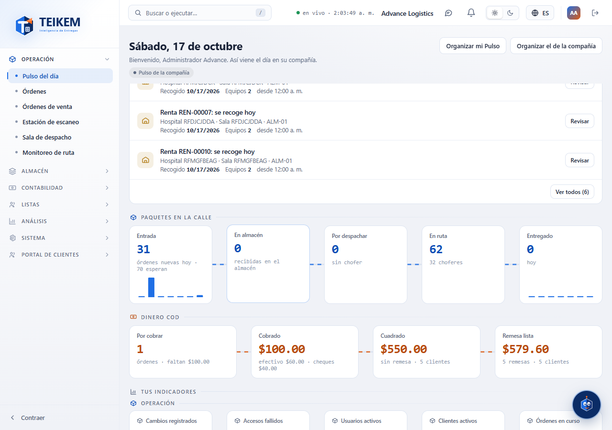
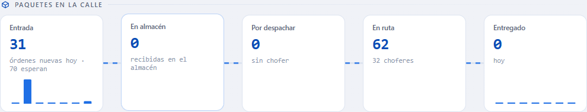

# L88 — Los dos ríos del Pulso

**Pulso del día** (`/`). Debajo de «Necesita tu atención» aparecen **Paquetes en la calle** (azul) y **Dinero COD** (naranja), cada uno con su permiso (`pulse.orders` / `pulse.cod`), sus datos (`orders.view` / `cod.view`) y su módulo. Qué cuenta cada tarjeta y los mensajes están en el [capítulo 07 §6](../07-pulso-y-actividad.md).

## Paquetes en la calle

Cinco tarjetas unidas por una tubería punteada: **Entrada** (órdenes nuevas hoy y cuántas esperan), **En almacén**, **Por despachar** (sin chofer), **En ruta** (con los choferes) y **Entregado** (hoy). **Entrada** y **Entregado** llevan **barritas de 7 días** (la última es hoy; el cursor dice la fecha y la cantidad). Un clic en la tarjeta abre donde se atiende: Órdenes, Sala de despacho o Monitoreo de ruta.

## Dinero COD

Cuatro tarjetas con la tubería naranja: **Por cobrar** (órdenes y lo que falta), **Cobrado** (con el desglose en efectivo y cheques), **Cuadrado** (sin remesa, con cuántos clientes) y **Remesa lista** (el neto por remitir). Un clic abre COD en la pestaña que corresponde (Envíos con COD, Reconciliar o Remesas).

## Organizar

Como cualquier panel, los ríos se **ordenan y se ocultan** desde «Organizar mi Pulso» (y el de la compañía con `pulse.organize_company`).

## Móvil

Desde 360 px las tarjetas pasan a dos por fila y las tuberías se ocultan; no hay scroll horizontal de página.
