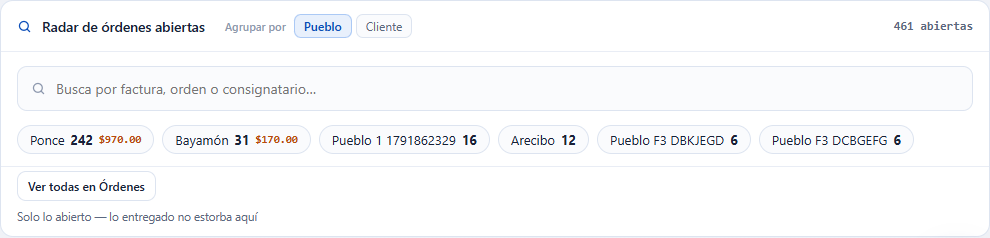
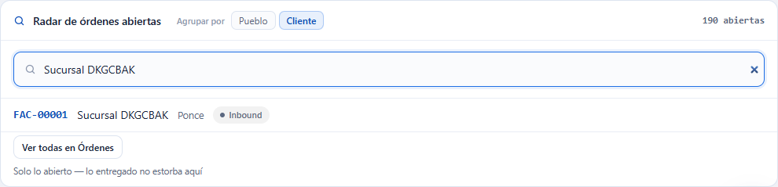

# L89 — Radar de envíos abiertos y avisos de operación

**Pulso del día** (`/`). El Radar es un panel (`RADAR`, orden 60; `pulse.orders` + `orders.view` + `LTL_GROUND`) y los avisos nuevos salen en «Necesita tu atención». Qué cuenta cada uno y los mensajes están en el [capítulo 07 §7](../07-pulso-y-actividad.md).

## El Radar

Arriba, cuántas órdenes hay **abiertas** y el selector **Agrupar por** (Pueblo o Cliente). Sin búsqueda se ven los grupos con más órdenes —con el COD que llevan—; un clic abre **Órdenes ya filtrado** (el pueblo o el cliente y solo lo abierto). **Ver todos en Envíos** abre la lista con solo lo abierto.

Con **2 letras o más** el buscador cambia los grupos por las órdenes abiertas que coinciden con la factura, el número, el empaque o el consignatario (hasta 6, con estatus y COD); un clic abre la orden. «Sin resultados en abiertas» si no hay.

## Avisos de «Necesita tu atención»

**N órdenes sin chofer** (Sin asignar o Asignadas sin ruta con chofer; con la más antigua y en rojo desde 2 días) lleva a la **Sala de despacho**; **$X de COD sin cuadrar** (con los cobros, las órdenes y el más antiguo; en rojo desde 3 días) lleva a **COD → Reconciliar**. Son filas resumen y salen **antes** que las filas por registro.

## Móvil

Desde 360 px el selector y el buscador ocupan el ancho y los grupos se acomodan en varias filas. No hay scroll horizontal de página.
