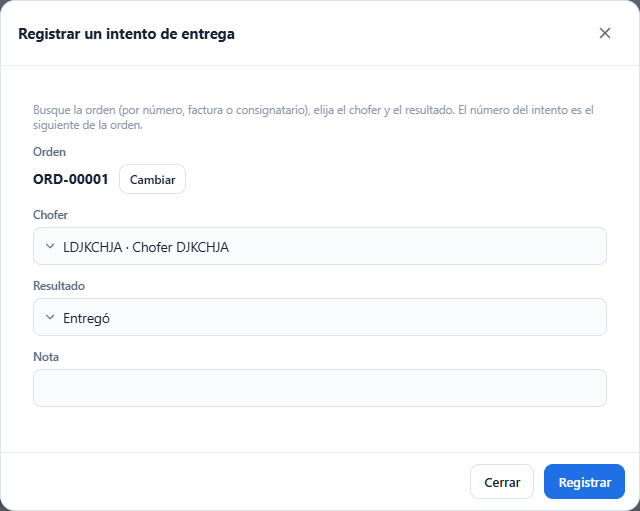
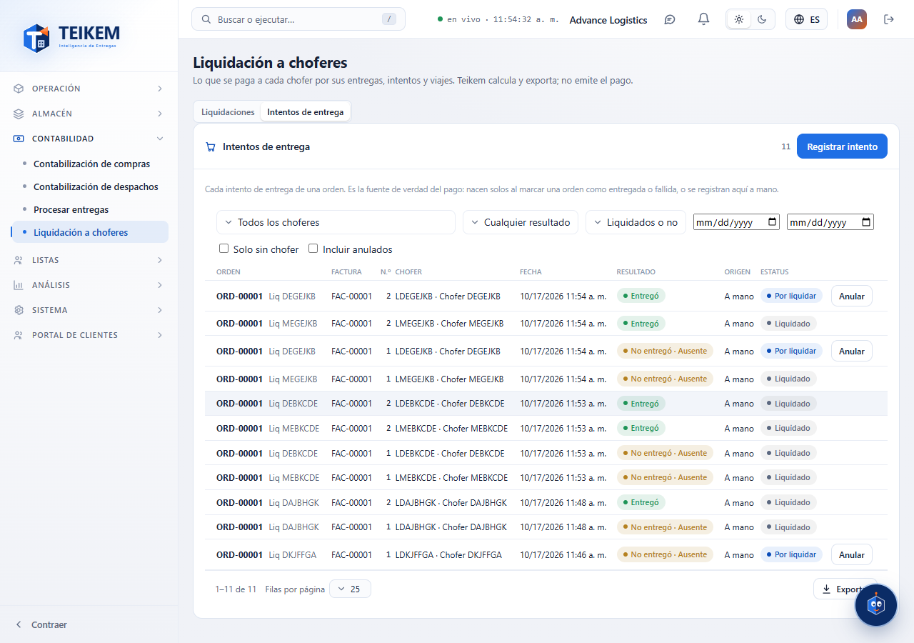
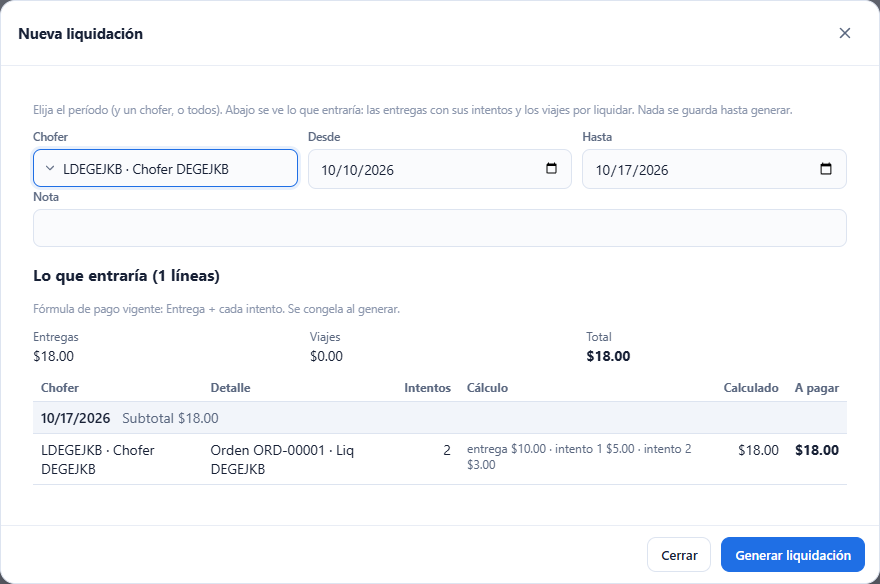
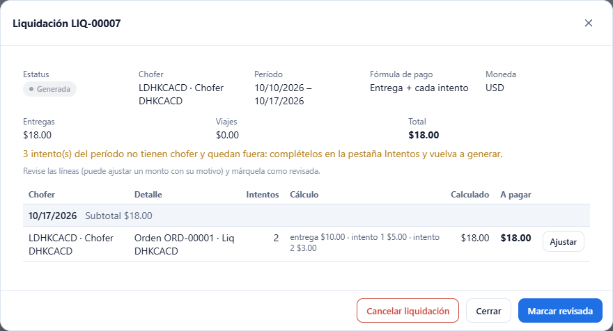
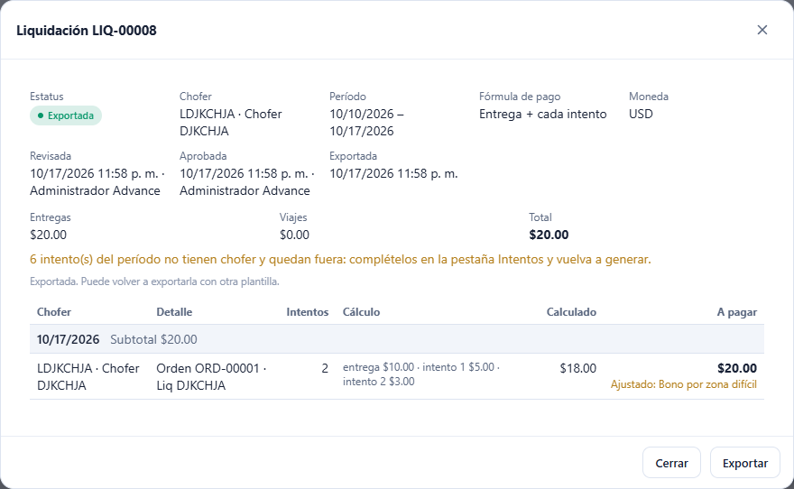
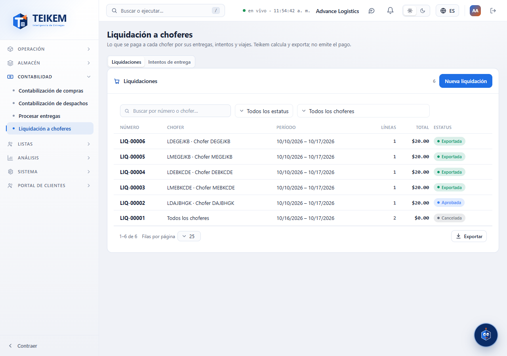

# L96 — Liquidación a choferes (pantalla)

Dónde: **Contabilidad → Liquidación a choferes** (`/money/driver-pay`; permiso `driverpay.view`, módulo `LTL_GROUND`). Las reglas, los endpoints y los mensajes de error están en el [capítulo 22](../22-liquidacion-choferes.md); aquí, cómo se usa la pantalla. La pantalla funciona de 360 px en adelante, sin scroll horizontal de página.

La pantalla tiene dos pestañas: **Liquidaciones** e **Intentos de entrega**.

## Intentos de entrega

La lista de todos los intentos (orden con su cliente, número de intento, chofer, fecha, resultado, origen y estado: por liquidar, liquidado o anulado). Filtros: chofer, resultado, liquidado o no, rango de fechas, «solo sin chofer» e «incluir anulados». Se exporta como las demás tablas.

- **Registrar intento** (`driverpay.manage`): se busca la orden escribiendo su número, factura o consignatario (3 caracteres o más) y se elige de la lista —el número de envío se repite entre clientes, por eso cada opción trae el consignatario—; se elige el chofer y el resultado (entregó o no entregó, con la razón del fallo y una nota). El número del intento es el siguiente de la orden.
- **Anular**: pide el motivo; no está disponible para un intento ya liquidado ni anulado.

## Liquidaciones

La lista trae número, chofer (o «Todos los choferes»), período, líneas, total y estatus; se busca por número o chofer y se filtra por estatus y chofer.

### Nueva liquidación

Se elige el período (por omisión, los últimos 7 días) y, si se quiere, un chofer. **Antes de guardar** se ve lo que entraría: las entregas con su desglose (entrega e intentos) y los viajes por liquidar, con el total, la fórmula de pago vigente y avisos si hay **intentos sin chofer** (quedan fuera) o **líneas sin tarifa** (salen en $0). «Generar liquidación» la crea y abre su ficha.

### La ficha

Estatus, chofer, período, fórmula de pago congelada, totales (entregas, viajes y total) y las **líneas agrupadas por día** con su subtotal. Cada línea muestra el cálculo (entrega e intentos), lo calculado y lo que se paga; una línea ajustada lo dice y muestra el motivo. Los botones cambian con el estatus y con el permiso:

| Botón | Cuándo | Permiso |
|---|---|---|
| **Ajustar** (por línea) | generada o revisada | `driverpay.manage` |
| **Marcar revisada** | generada | `driverpay.manage` |
| **Aprobar** (pide reautenticarse) | revisada | `driverpay.approve` |
| **Cancelar liquidación** (con confirmación) | generada o revisada | `driverpay.manage` |
| **Exportar** (elige la plantilla; descarga el archivo) | aprobada o exportada | `driverpay.export` |

**Ajustar**: se cambia el monto a pagar de la línea; el motivo es obligatorio si difiere de lo calculado (volver al calculado quita el ajuste). **Exportar** descarga el archivo y, si la liquidación estaba aprobada, pasa a **Exportada**. Sin el módulo de Facturación no se pueden elegir plantillas y se usa la estándar.

## Archivos
`features/driverpay/`: `DriverPayScreen.tsx`, `SettlementParts.tsx`, `AttemptParts.tsx`, `settlementApi.ts`, `settlementRules.ts`, `driverpay.css`; textos en `pay.*` (es/en); recorrido `e2e/lote96-liquidacion.spec.ts`.
