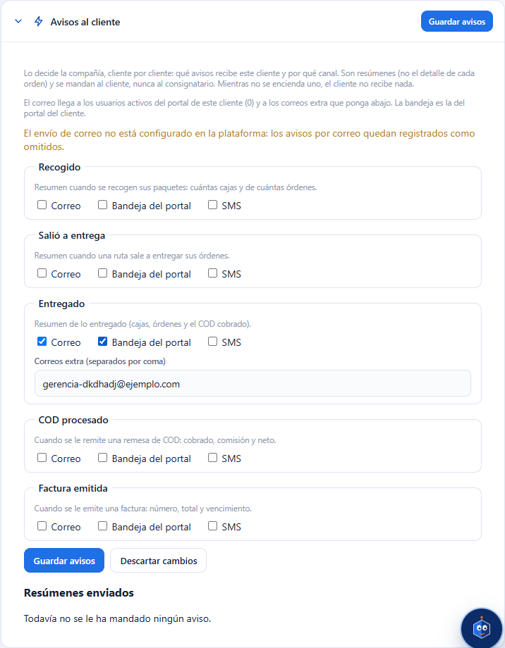
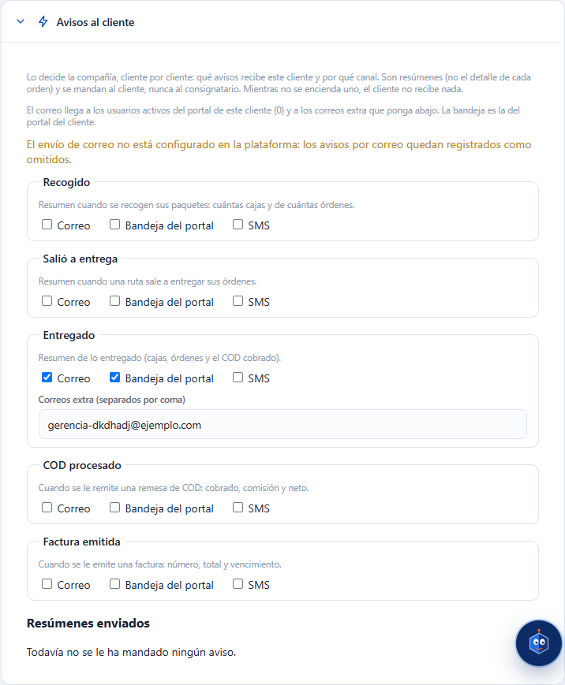

# L98 — Avisos al cliente (pantalla)

Dónde: **Clientes y contratos** (`/catalog/clients`), ficha del cliente, panel **«Avisos al cliente»** (nace plegado; el resumen del encabezado dice cuántos avisos tiene encendidos). Ver pide `clients.read`; cambiar, `clients.update`. Las reglas y los mensajes están en el [capítulo 23](../23-avisos-al-cliente.md).

## Qué se ve
- Una explicación (la decide la compañía, son resúmenes, van al cliente y nunca al consignatario), cuántos **usuarios del portal** recibirían el correo y, si hace falta, el aviso de que el correo no está configurado en la plataforma.
- **Cinco avisos** —Recogido, Salió a entrega, Entregado, COD procesado, Factura emitida—, cada uno con su explicación y tres casillas: **Correo**, **Bandeja del portal** y **SMS**. Todo apagado por omisión.
- Al encender **Correo** aparece **«Correos extra»**; al encender **SMS**, **«Teléfonos para SMS»** (con la nota de que el SMS no sale hasta contratar el proveedor).
- Un correo o teléfono mal escrito se avisa en el momento y **no deja guardar**. «Guardar avisos» (y «Descartar cambios») solo aparecen si hay cambios. Sin `clients.update` las casillas están apagadas y no hay botones.
- Abajo, **«Resúmenes enviados»**: fecha, aviso, el texto del resumen y los envíos (en el portal, enviados, omitidos, con error; el detalle sale al pasar el cursor).

Funciona de 360 px en adelante, sin scroll horizontal de página.

## Archivos
`features/clients/`: `ClientNotificationsPanel.tsx`, `notificationsApi.ts`, `notificationRules.ts`; textos en `clients.notif.*` (es/en); pruebas `ClientNotificationsPanel.test.tsx`, `notificationRules.test.ts` y el recorrido `e2e/lote98-avisos-cliente.spec.ts`.
