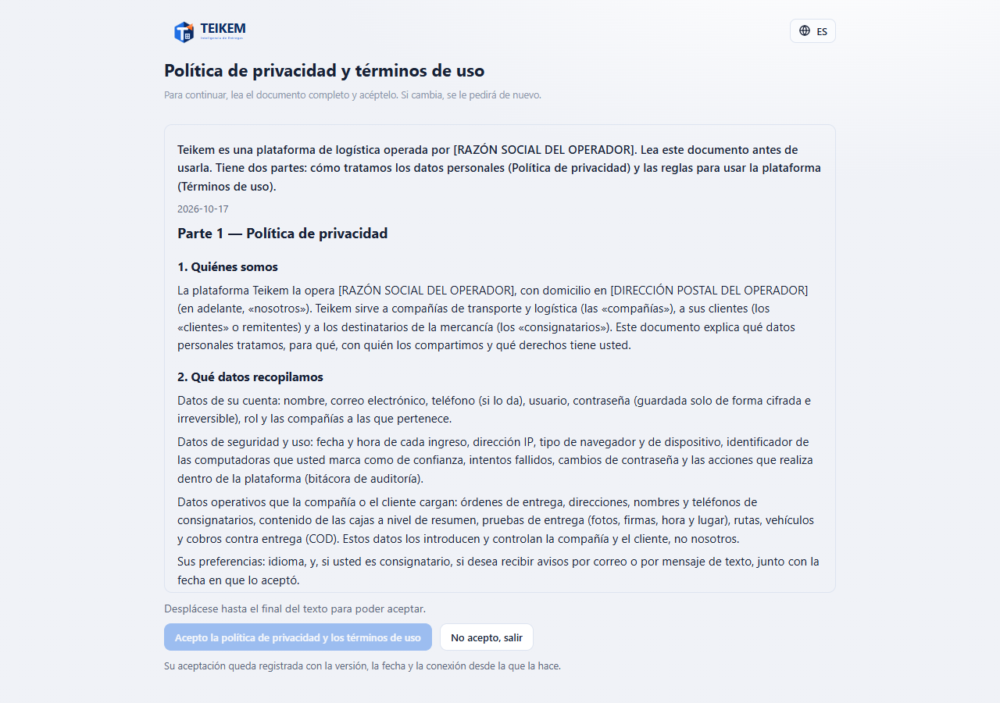
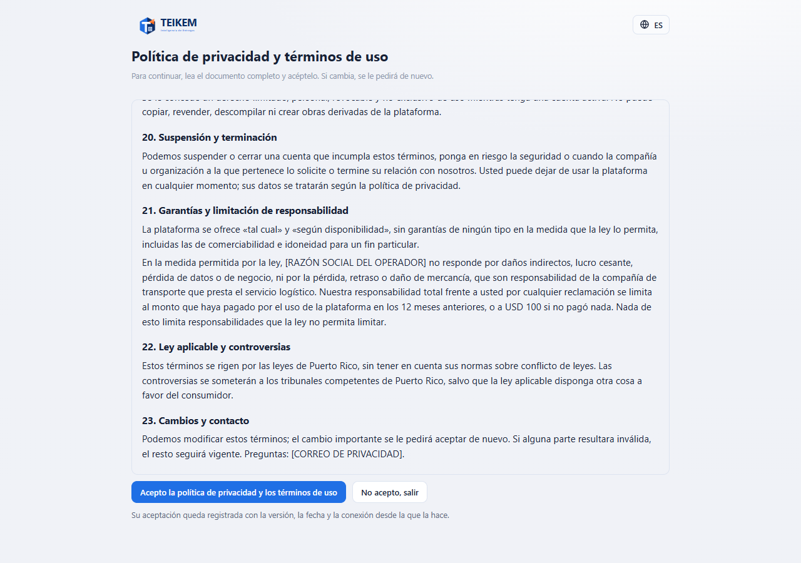
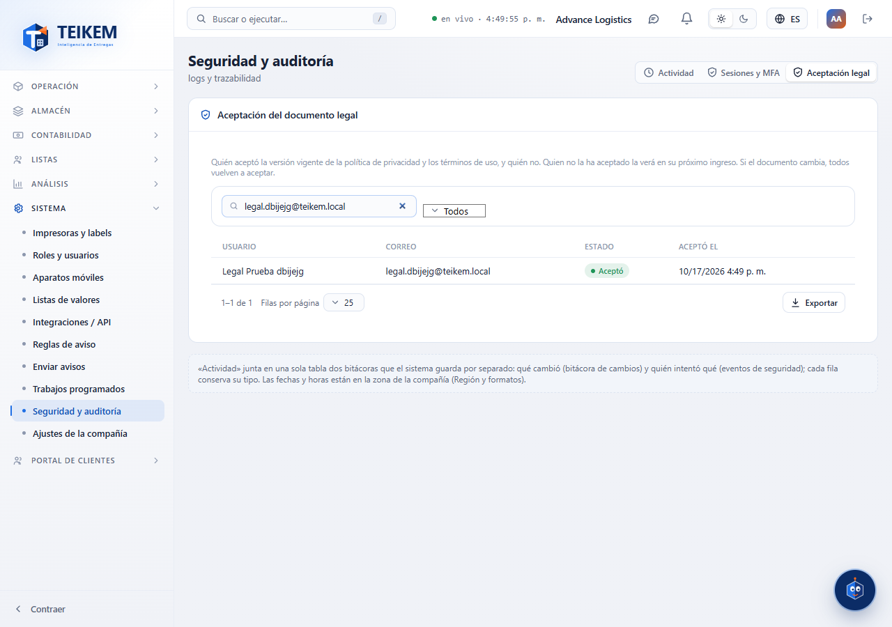

# L99 — Documento legal (pantallas)

Reglas y mensajes: [capítulo 24](../24-documento-legal.md).

## Primer ingreso (o nueva versión)

Después de entrar con la contraseña, en lugar de la aplicación sale **«Política de privacidad y términos de uso»**, un solo texto que se lee desplazando: Parte 1 (privacidad) y Parte 2 (términos). El botón **«Acepto la política de privacidad y los términos de uso»** está apagado y debajo dice «Desplácese hasta el final del texto para poder aceptar.».

Al llegar al final se habilita el botón. **«No acepto, salir»** cierra la sesión. Al aceptar entra a la aplicación y no se vuelve a pedir hasta que cambie la versión. Funciona de 360 px en adelante, sin scroll horizontal de página; el selector de idioma está arriba.

## Quién aceptó (administración)

**Seguridad y auditoría → Aceptación legal** (`admin.audit`): usuario, correo, estado (**Aceptó**, **Pendiente**, **Versión anterior**) y fecha; busca por nombre o correo, filtra por estado, ordena y exporta todo lo filtrado.

## Archivos
`features/legal/`: `LegalAcceptPage.tsx`, `LegalGate.tsx` (montada en `RequireAuth`), `LegalDocumentView.tsx`, `LegalPage.tsx` (`/legal`, sin sesión), `LegalAcceptancesTab.tsx`, `legalApi.ts`, `legalRules.ts`, `legal.css`; textos `legal.*` y `system.audit.tabs.legal` (es/en); pruebas `legal.test.tsx` y el recorrido `e2e/lote99-documento-legal.spec.ts`.
